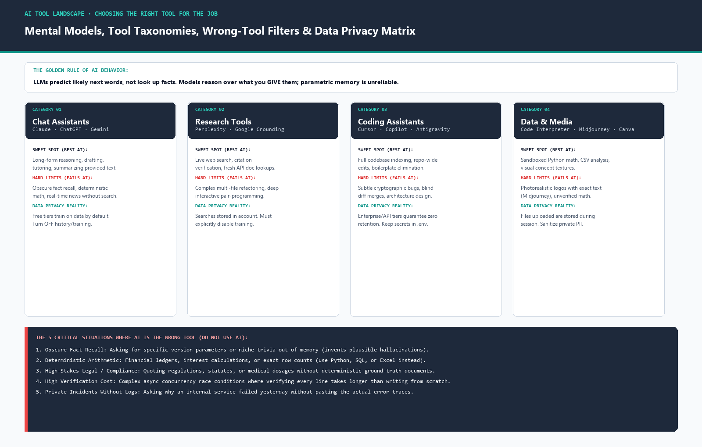

# AI Tool Landscape: Choosing the Right Tool For the Job

> **Executive Summary:** Most people fail with AI because they misunderstand its fundamental behavior: a language model predicts likely next words, it does not look things up. It reasons exceptionally well over what you put into its context window, but remembering facts from training weights is lossy and unreliable. This guide establishes the non-technical mental model, the pre-prompt "wrong tool" filter, the comprehensive tool taxonomy, and the data privacy rules governing modern AI adoption.

---

## 1. The Core Mental Model (Without Any Math)

Detailed guide: [`mental-model-and-failure-modes.md`](./mental-model-and-failure-modes.md)

1. **Next-Token Prediction Engine:** An LLM does not possess an internal fact database or an intentional mind. Given a sequence of input tokens, it calculates a probability distribution over its vocabulary and samples the most statistically probable continuation.
2. **Context Window vs. Training Weights:**
   - **In-Context Reasoning (Working Memory):** High reliability (95–99%). Give the model a Python file, a SQL schema, or a policy document and ask it to analyze, refactor, or extract information.
   - **Parametric Recall (Frozen Memory):** Low reliability (50–70%). Asking the model to recall niche API flags, exact dates, or obscure trivia from its frozen weights triggers hallucination.
3. **Why Models Hallucinate & Cannot Say "I Don't Know":** Language models are trained to maximize likelihood across smooth text distributions. Without explicit grounding or system prompt constraints, admitting ignorance has a lower statistical probability than generating a plausible-sounding, authoritative completion.

---

## 2. Predicting the "Wrong Tool" Before You Prompt

Detailed guide: [`when-not-to-use-ai.md`](./when-not-to-use-ai.md)

In client work and software engineering, **a wrong fact that ships costs 10x to 100x more than doing the task by hand**. Before delegating work to an AI model, apply Ethan Mollick's *15 vs. 5* filter:

| The 5 Times AI is the WRONG Tool | Why It Fails | What to Use Instead |
| :--- | :--- | :--- |
| **1. Obscure Fact Retrieval** | Model hallucinates plausible-sounding but fictitious details from sparse weights. | Perplexity, official docs, or primary sources. |
| **2. Deterministic Arithmetic & Math** | LLMs lack an Arithmetic Logic Unit (ALU); they predict numbers linguistically. | Python, SQL, Excel, or Code Interpreter. |
| **3. High-Stakes Compliance / Legal** | Confident hallucinations can result in severe legal or financial liability. | Validated legal databases and human counsel. |
| **4. Verification Cost > Creation Cost** | Reviewing subtle async race conditions takes 45 mins; manual writing takes 20 mins. | Write from scratch; use AI only for tests/docs. |
| **5. Private Outages Without Logs** | Model has zero internal visibility into your infrastructure. | Check Datadog, CloudWatch, or local container logs. |

---

## 3. The Tool Landscape Map & Sweet Spots

Detailed guide: [`tool-comparison-and-privacy-matrix.md`](./tool-comparison-and-privacy-matrix.md)

- **Chat Assistants (`Claude`, `ChatGPT`, `Gemini`):** Best for multi-turn thinking, drafting, tutoring, and refactoring provided code.
- **Research Tools (`Perplexity`, `Google Grounding`):** Best for checking claims against live web sources with inline citations.
- **Coding Assistants & Agents (`Cursor`, `GitHub Copilot`, `Antigravity`):** Best for whole-repo indexing, boilerplate removal, and multi-file diff generation.
- **Data Sandboxes (`Code Interpreter` / Python Sandbox):** Best for deterministic math, CSV processing, and automated data plotting.
- **Media Generators (`Midjourney`, `DALL-E 3`, `Canva`):** Best for moodboards, textures, and clean vector layout generation.

---

## 4. Data Privacy, Retention & Enterprise Security

> **Default Rule:** Assume all inputs into free consumer tools are logged and potentially used for model training unless protected by enterprise terms or explicit opt-outs.

- **OpenAI Free/Plus:** Opt out under *Settings → Data Controls → Turn off "Improve the model for everyone"*.
- **Anthropic Free/Pro:** Does not train on consumer conversations by default, but human safety review may occur.
- **Commercial APIs (OpenAI / Anthropic / Google Cloud Vertex AI):** Zero model training on customer data by default, with strict 30-day abuse retention or Zero Data Retention (ZDR) options.
- **Sanitization Protocol:** Never paste API keys, database connection strings, passwords, or customer PII into consumer chats. Use `.env.example` templates and synthetic data.
