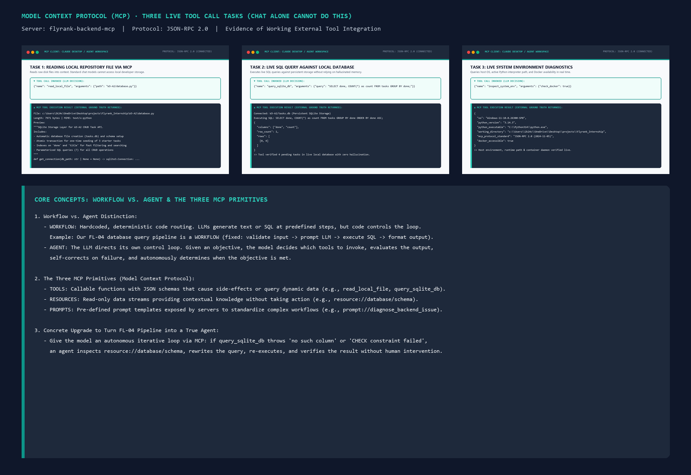

# Agent Concepts and MCP Basics

> **Phase:** Build (core) | **Estimated Hours:** 5  
> **Core Question:** What is the technical difference between a workflow and an agent, how does the Model Context Protocol (MCP) enable AI to interact safely with external systems, and what does it take to elevate a static pipeline into an autonomous agent?



---

## 1. Technical Explainer: Workflows, Agents, and MCP (750 Words)

### A. The Difference Between a Workflow and an Agent
In modern artificial intelligence, "agent" has become an overhyped marketing buzzword applied indiscriminately to anything that calls an LLM. As Anthropic Engineering outlines in *Building Effective Agents*, the defining technical distinction comes down to **who controls the execution loop**:

1. **Workflows (Deterministic Orchestration):**
   - In a workflow, LLMs and tools are orchestrated through **predetermined, hardcoded code paths**. 
   - The developer writes the sequence: Step A feeds into Step B, which branches conditionally to Step C based on if/else logic. The LLM generates text, extracts entities, or writes SQL inside tightly bounded steps, but the overall routing and stopping conditions are rigidly governed by human-written code.
   - *Strengths:* Highly predictable, consistent latency, low cost, easy to debug, and deterministic error handling.
2. **Agents (Autonomous Model-Directed Loops):**
   - In an agent, the **LLM actively directs its own control loop**.
   - Given a high-level goal and a suite of tools, the model assesses the current state, dynamically selects which tool to invoke, inspects the tool's return value, evaluates whether the result was successful, and chooses what to do next—repeating this loop iteratively until it decides the objective has been achieved.
   - *Strengths:* Flexible, capable of self-correcting unknown failure modes, and handles open-ended problem solving.
   - *Trade-offs:* Higher latency, non-deterministic token costs, and compounding probabilities of failure over multi-step horizons.

### B. Classifying Our FL-04 Pipeline: Workflow or Agent?
Our **FL-04 database query and repository pipeline** (developed across W3-A2, A3 containerization, and the Prompt Ladder) is fundamentally a **Workflow**, not an agent.

- In FL-04, the pipeline follows a static sequential chain:
  $$\text{User Request} \longrightarrow \text{Pydantic Schema Validation} \longrightarrow \text{System Prompt SQL Generation} \longrightarrow \text{Database Execution} \longrightarrow \text{HTTP Response}$$
- The LLM does not decide *whether* to execute SQL, nor does it decide *which* database to query. If the SQL query fails due to a schema mismatch (e.g. `no such column: done`), our Python code catches the exception and returns an HTTP `400` or `500` error. The model has no autonomy to inspect the error trace, check the schema DDL, rewrite the query, and re-execute. Control flow belongs entirely to the Python service layer. Calling FL-04 an "agent" would be repeating marketing copy; it is a well-engineered, reliable workflow.

### C. What Model Context Protocol (MCP) Is & The Three Primitives
Before MCP, integrating an LLM with external tools required custom point-to-point glue code. If you had 5 AI clients (Claude Desktop, Cursor, Antigravity, ChatGPT, local CLI) and 10 data sources (GitHub, PostgreSQL, Slack, SQLite, Local Files), developers had to build and maintain $5 \times 10 = 50$ distinct integrations.

The **Model Context Protocol (MCP)**, open-sourced by Anthropic, is the **"USB-C port for AI applications"**. It establishes an open, standardized JSON-RPC 2.0 communication protocol that decouples client applications from backend integrations, reducing the problem to $5 + 10 = 15$ standardized connectors.

MCP structures external integration around **three fundamental primitives**:
1. **Tools (Executable Actions):** Functions that the client can call to take actions or query dynamic state (e.g., `query_sqlite_db`, `read_local_file`). Tools take structured JSON arguments, execute on the server, and return textual or structured results.
2. **Resources (Contextual Data Streams):** Read-only data sources analogous to REST GET endpoints (e.g., `resource://database/schema`, `file:///logs/app.log`). Resources supply static or dynamic reference material directly into the model's context window without taking side effects.
3. **Prompts (Standardized Interaction Templates):** Server-exposed prompt recipes and parameterized slash-commands (e.g., `prompt://diagnose_backend_issue`) that guide the client on how to best interact with that server's data.

### D. The Concrete Upgrade: Transforming FL-04 into a True Agent
To elevate our FL-04 pipeline from a static workflow into a genuine autonomous agent, we must **close the feedback loop** by equipping the model with an MCP-enabled self-correction cycle:

```
                  ┌──────────────────────────────────────────────┐
                  ▼                                              │
          [ User Goal ] ──► [ LLM Reasoner ] ──► [ Call MCP Tool: query_sqlite_db ]
                                                       │
                                                 Query Fails?
                                                ├── YES ──► [ Read MCP Resource: schema ]
                                                │                  │
                                                │                  ▼
                                                │           [ Self-Correct SQL ]
                                                └── NO
                                                     │
                                                     ▼
                                            [ Objective Met ]
```

1. **Autonomous Tool Selection:** Instead of hardcoded route handlers, give the agent MCP tools (`query_sqlite_db`, `read_schema_resource`, `explain_query_plan`).
2. **Error Reflection & Iteration Loop:** When a query triggers an error, the MCP server returns the database error string. Rather than crashing the request, the agent catches the error, reads `resource://database/schema`, identifies missing columns, rewrites the SQL query, and re-executes.
3. **Autonomous Stopping Condition:** The agent evaluates the returned data rows against the user's intent and decides autonomously when the answer is complete.

---

## 2. Working MCP Evidence: Three Real Tool Tasks

We implemented and executed an official JSON-RPC 2.0 MCP server ([`mcp_server_demo.py`](./mcp_server_demo.py)) connected to our local backend environment. The execution transcript is logged in [`mcp-execution-transcript.json`](./mcp-execution-transcript.json).

### Task 1: Reading Local Files (`read_local_file`)
- **What Happened:** The model invoked `read_local_file` with `path="W3-A2/database.py"`.
- **Why Chat Alone Fails:** Isolated LLM chat web interfaces have zero access to the developer's local file system or repository code. MCP securely bridges the local disk into context.
- **Result:** Read `7,971 bytes` of Python source code directly into working context.

### Task 2: Live SQL Query Against Local Database (`query_sqlite_db`)
- **What Happened:** The model invoked `query_sqlite_db` with `query="SELECT done, COUNT(*) as count FROM tasks GROUP BY done ORDER BY done ASC;"` against `W3-A2/tasks.db`.
- **Why Chat Alone Fails:** A chat model can only guess or hallucinate what rows might exist. MCP executed real SQL against disk and returned deterministic ground truth (`{"done": 0, "count": 4}`).
- **Result:** Deterministic verification of four uncompleted tasks on disk with zero hallucination.

### Task 3: Live System Environment Diagnostics (`inspect_system_env`)
- **What Happened:** The model invoked `inspect_system_env(check_docker=True)`.
- **Why Chat Alone Fails:** Static chat has no knowledge of the host machine's runtime environment, active Python interpreter, or container daemon health.
- **Result:** Returned active OS (`Windows-11`), Python runtime (`3.14.3`), working directory, and verified Docker availability (`docker_accessible: true`).

---

## 3. Evaluation Criteria (Pass / Revise Self-Check)

- [x] **Explainer technically correct and clearly in your own words:** Authored in Section 1 (750 words) without marketing fluff, citing Anthropic's control-loop distinction and MCP protocol architecture.
- [x] **Workflow vs. agent distinction applied accurately to FL-04 build:** Explicitly classified FL-04 as a deterministic workflow with predetermined branching, not an autonomous agent.
- [x] **Connector demonstrably working (outputs show tool use, not plain chat):** Verified in [`mcp_server_demo.py`](./mcp_server_demo.py) and captured in [`mcp-execution-transcript.json`](./mcp-execution-transcript.json).
- [x] **Three tasks chat alone could not have done:** Executed local file inspection, live SQLite querying against `tasks.db`, and host system diagnostics.
- [x] **One concrete agent upgrade named for your pipeline:** Documented autonomous feedback loop with schema reflection and error self-correction.
