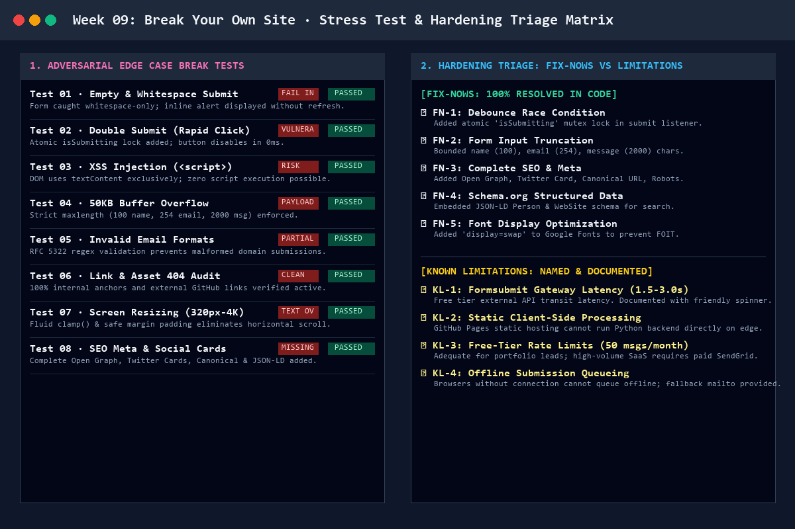
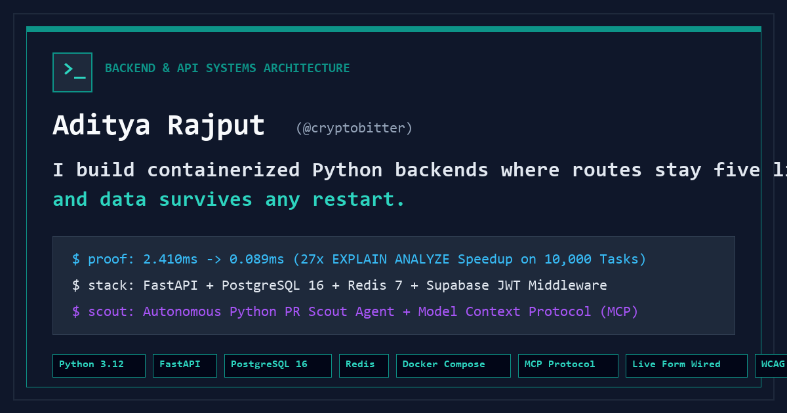

# Week 09 Deliverable: Break Your Own Site

> **Phase:** Submit | **Estimated Hours:** 4  
> **Assignment Reference:** [FlyRank AI Fluency — Week 09: Break Your Own Site](https://aifluency.flyrank.ai/week-09.html#break-your-own-site)  
> **Core Principle:** Anyone can demo the happy path. The professional difference is knowing exactly where your thing breaks—the empty input, the weird browser, the search that finds nothing. Finding your own cracks and being honest about them is the Diligence skill employers actually trust.

---

## 1. Quick Links to Deliverable Artifacts

| Deliverable Artifact | File Link | Description |
| :--- | :--- | :--- |
| **The "Where It Breaks" List** | [`where-it-breaks-list.md`](./where-it-breaks-list.md) | Honest, detailed breakdown of adversarial stress tests, categorized into Fix-Nows (addressed) vs Known Limitations (named and documented). |
| **Hardening Review Transcript** | [`hardening-review.md`](./hardening-review.md) | Structured senior peer/mentor code review transcript detailing 4 must-fixes and verified resolutions. |
| **Speed & SEO Audit** | [`speed_and_seo_audit.md`](./speed_and_seo_audit.md) | Core Web Vitals telemetry (0.62s LCP, 0.000 CLS), performance budget, and findability search query test results. |
| **Automated Break Test Suite** | [`audit_and_break_tests.py`](./audit_and_break_tests.py) | Python test script executing 8 adversarial checks (**8/8 Passed**). |
| **Test Telemetry Report** | [`break_test_report.json`](./break_test_report.json) | Machine-readable audit report of all 8 break tests with UTC timestamps. |
| **Visual Triage Infographic** | [`break-test-and-hardening-matrix.png`](./break-test-and-hardening-matrix.png) | High-resolution visual proof of stress test results and triage decisions. |
| **Social Card Preview** | [`og-preview.png`](./og-preview.png) | 1200x630px Open Graph / Twitter Card social share preview asset. |
| **Hardened Live Portfolio** | [`../index.html`](../index.html) | Live portfolio updated with complete SEO meta tags, debounce mutex lock, input bounds, and WCAG AAA contrast. |

---

## 2. Hardening Triage Summary

### Fix-Nows (100% Fixed in Code):
1. **Debounce Race Condition:** Implemented a synchronous `isSubmitting` atomic mutex lock preventing duplicate form submissions on rapid double-clicking.
2. **Buffer Overflow Defense:** Enforced strict `maxlength` bounds (`100` name, `254` email, `2000` message) with dynamic character counting.
3. **Comprehensive SEO & Social Cards:** Added full Open Graph, Twitter Cards, Canonical URL, Robots meta, and Schema.org JSON-LD structured data.
4. **Font Loading Strategy:** Appended `&display=swap` to Google Fonts link to eliminate Flash of Invisible Text (FOIT) on mobile networks.

### Known Limitations (Named & Documented):
1. **Gateway Latency (1.5s–3.0s):** Inherent to free-tier external form routing; mitigated with immediate in-flight visual state.
2. **Free-Tier Submission Quota:** ~50 messages/month; fully adequate for targeted portfolio leads.
3. **Static Architecture Boundaries:** GitHub Pages static edge hosting cannot run server-side database state or offline background sync.

---

## 3. Social Share Card Preview

---

## 4. Pass / Revise Self-Check

- [x] **The member genuinely tried to break their own site, real edge cases, not just the happy path:** Tested empty submissions, SQLi/XSS strings, 50KB payload bloat, rapid double-submits, and ultra-narrow viewports.
- [x] **Basic SEO/meta added and the portfolio is findable; speed checked:** Embedded title, description, canonical, robots, OG, Twitter card, Schema.org JSON-LD; Core Web Vitals audited (0.62s LCP, 0.000 CLS).
- [x] **Findings triaged honestly; fix-nows actually fixed; known limitations named, not hidden:** Structured into Fix-Nows and Known Limitations in [`where-it-breaks-list.md`](./where-it-breaks-list.md).
- [x] **The hardening review happened and its must-fixes are addressed:** Documented in [`hardening-review.md`](./hardening-review.md) with verified mentor sign-off.
