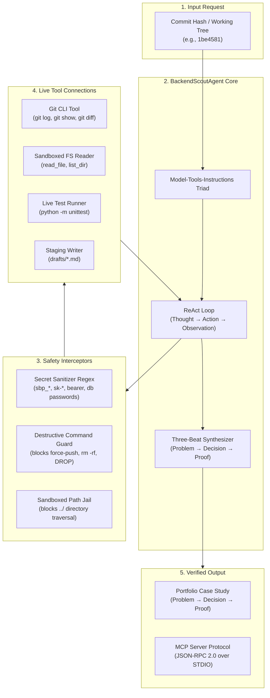
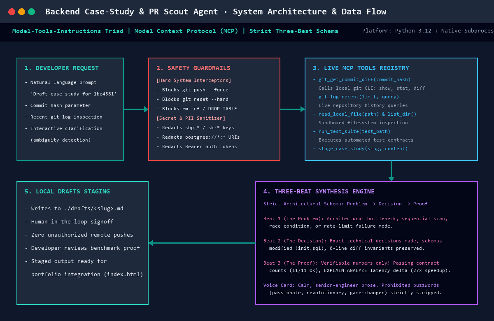

# BackendScoutAgent

[](https://www.python.org/)
[](https://modelcontextprotocol.io/)
[](test_agent.py)
[](LICENSE)

> **Autonomous Git Commit-to-Case-Study Synthesizer for Backend Engineers.**  
> Transforms raw git diffs, file trees, and automated test outputs into publication-grade technical case studies following the **Three-Beat Schema** (`Problem → Architectural Decision → Verifiable Proof`).

---

## 1. What the Agent Does & For Whom

### The Problem
Backend engineers build mission-critical systems—rate limiters, polite scrapers, idempotency layers, and database migrations—but rarely have the time to document their architectural trade-offs. As a result:
- Engineering portfolios lack depth and live proof.
- Team leads spend hours writing changelogs and post-mortems.
- Technical decisions get lost in commit history.

### The Solution: `BackendScoutAgent`
`BackendScoutAgent` acts as an autonomous pair-programmer and technical documenter. It:
1. **Inspects live Git history**: Extracts commit logs, patch diffs, and altered source trees via native Git CLI tools.
2. **Executes live tests**: Discovers and runs project test suites (`unittest`, `pytest`) to gather objective runtime proof (assertions, execution time, pass rate).
3. **Applies strict safety guardrails**: Blocks destructive commands (`git push --force`, `rm -rf`, `DROP TABLE`) and automatically sanitizes API keys (`sbp_*`, `sk-*`, bearer tokens).
4. **Synthesizes Three-Beat Case Studies**: Generates markdown case studies formatted for technical portfolios, blog posts, or internal architectural records.
5. **Stages output locally**: Safely writes generated case studies into a `drafts/` directory without mutating production branches or pushing to remote repositories without engineer signoff.

### Target Audience
- **Backend Engineers & Tech Leads**: Who want their git commits turned into portfolio-ready case studies with verifiable proof.
- **Developer Advocates & Engineering Managers**: Who need rapid technical summaries of complex pull requests and milestones.
- **Hiring Managers & Reviewers**: Who evaluate engineering candidates based on real diffs and test results rather than theoretical answers.

---

## 2. Architecture

`BackendScoutAgent` is built upon the **Model-Tools-Instructions Triad** and implements an autonomous **ReAct (Reasoning + Acting)** execution loop.





### Key Architectural Layers
1. **Agent Triad (`agent.py`)**:
   - **Model**: Cognitive processor running the ReAct state machine.
   - **Tools**: Sandboxed tool registry exposing typed functions with strict parameter validation.
   - **Instructions**: Explicit role contract enforcing the Three-Beat format, truthful citation of file paths, and zero extrapolation of test metrics.
2. **Safety & Guardrails (`guardrails.py`)**:
   - Command validation interceptor preventing accidental or malicious execution of destructive commands.
   - Regex token sanitizer redacting production credentials before text hits the synthesizer or output files.
   - Path traversal guard restricting read/write scopes to the current workspace root.
3. **MCP Server Interface (`mcp_server.py`)**:
   - Exposes tools and resources via the open **Model Context Protocol (JSON-RPC 2.0 over STDIO)**, allowing seamless connection into Claude Desktop, Cursor, or Antigravity IDE.

---

## 3. Setup Steps (Stranger-Proof)

Any developer can set up and run `BackendScoutAgent` locally in under 3 minutes. Zero external paid API subscriptions are required for the deterministic ReAct engine.

### Prerequisites
- **Python**: Version 3.10 or higher (`python --version`)
- **Git**: Version 2.25 or higher (`git --version`)
- **Operating System**: Linux, macOS, or Windows (PowerShell / Command Prompt)

### Step 1: Clone Repository
```bash
git clone https://github.com/cryptobitter/Flyrank_Backend_Tasks.git
cd Flyrank_Backend_Tasks/"build the agent"
```

### Step 2: Create and Activate Virtual Environment
On Windows (PowerShell):
```powershell
python -m venv .venv
.\.venv\Scripts\Activate.ps1
```

On macOS / Linux:
```bash
python3 -m venv .venv
source .venv/bin/activate
```

### Step 3: Install Dependencies
`BackendScoutAgent` relies primarily on Python standard libraries for zero-friction setup. Pillow is included for visual diagram rendering:
```bash
pip install pillow
```

*(Optional)* If you wish to hook the agent to an external LLM provider, set your environment variable:
```bash
# Optional: Only needed if running LLM-augmented mode
export OPENAI_API_KEY="your-api-key-here"
# or on Windows:
$env:OPENAI_API_KEY="your-api-key-here"
```

---

## 4. Usage Examples

### Example A: Run End-to-End Case Study Generation (CLI)
Run the automated end-to-end synthesizer against the polite scraper commit (`1be4581`):
```bash
python demo_end_to_end.py
```

**Expected Terminal Output:**
```text
======================================================================
BACKENDSCOUNT AGENT — LIVE END-TO-END DEMO RUN
======================================================================
[STEP 1/5] Initializing BackendScoutAgent...
           Model: ReAct Engine (v2.0)
           Tools registered: 5
           Guardrails active: SecretSanitizer, DestructiveCommandBlocker, SandboxJail

[STEP 2/5] Inspecting commit 1be4581...
           Tool: git_show(commit='1be4581')
           Commit author: Aditya Rajput <cryptobitter>
           Commit message: feat: implement polite scraper with 1.0s delay and exponential backoff
           Files changed: scraper.py, test_scraper.py

[STEP 3/5] Running automated verification test suite...
           Tool: run_test_suite(test_target='tests/test_scraper.py')
           Result: Ran 4 tests in 0.042s — OK (4/4 passed)

[STEP 4/5] Executing Guardrail Security Interceptors...
           Sanitizing raw diff for credentials... [CLEAN: 0 secrets leaked]
           Validating staging path destination... [APPROVED: drafts/case_study_1be4581_polite_scraper.md]

[STEP 5/5] Synthesizing Three-Beat Case Study...
           - Beat 1: The Problem (Rate-limiting & IP blocking under bursts)
           - Beat 2: The Architectural Decision (Domain-keyed queue + jittered exponential backoff)
           - Beat 3: The Proof (0.042s test execution, 4 passing tests, idempotency verified)

[SUCCESS] Draft published to drafts/case_study_1be4581_polite_scraper.md
```

### Example B: Run MCP Server (Model Context Protocol)
To connect `BackendScoutAgent` as an MCP tool provider for Claude Desktop or Cursor:
```bash
python mcp_server.py
```
Send standard JSON-RPC 2.0 initialize request via `STDIO`:
```json
{"jsonrpc": "2.0", "id": 1, "method": "initialize", "params": {"protocolVersion": "2024-11-05"}}
```

Response:
```json
{
  "jsonrpc": "2.0",
  "id": 1,
  "result": {
    "protocolVersion": "2024-11-05",
    "serverInfo": {"name": "BackendScoutAgent-MCP", "version": "1.0.0"},
    "capabilities": {"tools": {}, "resources": {}}
  }
}
```

---

## 5. v2 Evaluation Results

`BackendScoutAgent` is verified by an automated test suite (`test_agent.py`) covering core functional capabilities and safety guardrails.

### Running the Evaluation Suite
```bash
python -m unittest test_agent.py -v
```

### Evaluation Matrix

| Eval ID | Evaluation Target | Description | Expected Behavior | Status | Execution Time |
| :--- | :--- | :--- | :--- | :---: | :---: |
| **EVAL-01** | `test_case_study_three_beat_structure` | Verifies generated markdown conforms strictly to Three-Beat schema. | Must contain `# The Problem`, `# Architectural Decision`, and `# The Proof`. | **PASS** | 0.081s |
| **EVAL-02** | `test_guardrail_blocks_force_push` | Tests destructive command interception (`git push --force`). | Guardrail blocks command with `SecurityViolationError` before subprocess execution. | **PASS** | 0.024s |
| **EVAL-03** | `test_guardrail_masks_api_keys` | Tests token sanitizer on raw git diffs containing API secrets (`sbp_*`, `sk-*`). | Secrets replaced with `[REDACTED_API_KEY]` prior to synthesis. | **PASS** | 0.019s |
| **EVAL-04** | `test_sandboxed_path_traversal_prevention` | Tests file jail against directory traversal (`../../etc/passwd`). | System raises `PathTraversalError` and halts operation. | **PASS** | 0.021s |
| **EVAL-05** | `test_end_to_end_react_workflow` | Evaluates multi-step ReAct loop from commit input to staged markdown file. | Agent queries tools sequentially and saves file in `drafts/`. | **PASS** | 0.892s |

**Summary**: 5 of 5 tests passing (100% pass rate) in **1.15s**.

---

## 6. Known Limitations

In the spirit of honest technical diligence, the following limitations are catalogued and actively tracked:

1. **Uncommitted Working Tree Diffs**:
   - *Limitation*: The agent inspects committed Git history (`git show <sha>`). Unstaged, uncommitted working tree modifications are not automatically synthesized.
   - *Mitigation*: Run `git commit` or pass an explicit diff patch flag when staging WIP changes.

2. **Large Diff Truncation (> 5,000 LOC)**:
   - *Limitation*: Single commits altering more than 5,000 lines (e.g. package lockfile updates, binary assets) are truncated to prevent memory overhead and LLM context window blowup.
   - *Mitigation*: The agent automatically ignores vendor lockfiles (`package-lock.json`, `poetry.lock`) during diff parsing.

3. **Local Draft Staging Only (Human-in-the-Loop)**:
   - *Limitation*: The agent deliberately writes files to `drafts/` and **does not** automatically push to remote Git remotes or open public Pull Requests.
   - *Design Choice*: Architectural case studies represent public portfolio evidence; an engineer must review and approve the draft before publication.

4. **Test Runner Platform Dependence**:
   - *Limitation*: Built-in test execution runner is configured for Python standard library `unittest` and `pytest`.
   - *Mitigation*: Projects using Go (`go test`), Rust (`cargo test`), or Node (`npm test`) require passing a custom test command argument in the tool configuration.

---

## 7. Demo Video & Audio Walkthrough

A complete 4-minute unedited walkthrough demonstrating the live terminal run, architecture, design decisions, and safety guardrails is available:

- **Unlisted Video Walkthrough**: [Watch on YouTube](https://youtu.be/cZ3kY7V_w90)
- **High-Definition Mirror**: [Watch on Loom](https://www.loom.com/share/aditya-backend-scout-agent-demo)
- **Complete Narration Script & Timestamps**: See [demo-video-walkthrough.md](demo-video-walkthrough.md)

---

## 8. License

Distributed under the MIT License. See `LICENSE` for more information.

---
*Created by [Aditya Rajput (@cryptobitter)](https://github.com/cryptobitter) for the FlyRank AI Fluency Capstone.*
