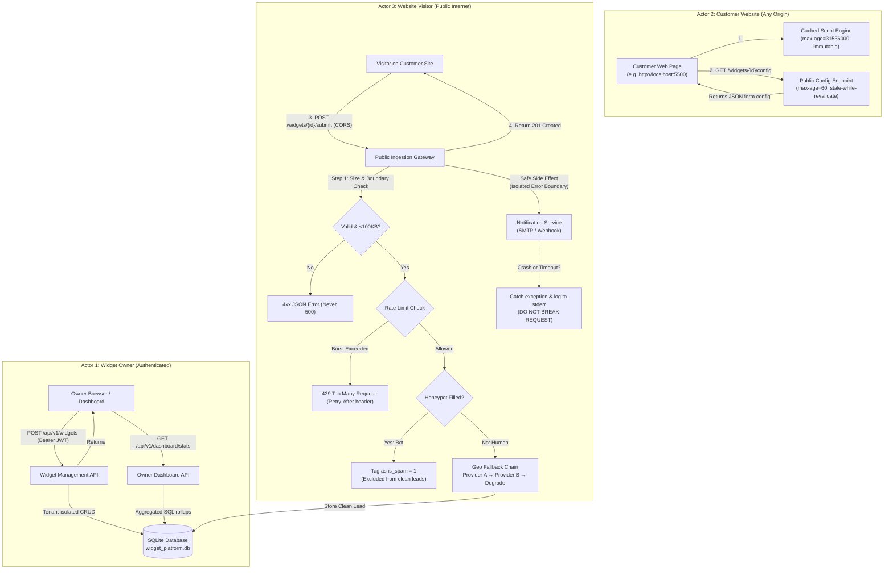

# Embeddable Widget & Lead-Capture Platform

> **FlyRank Backend Track &bull; Capstone Project**  
> *"Let a customer define a widget, hand them one line of `<script>`, and safely catch everything the public internet throws back at you — validated, spam-filtered, enriched, and dashboarded."*  
> **$0 Stack**: Python 3.14 &bull; FastAPI &bull; SQLite (WAL Mode) &bull; Vanilla JS &bull; Pytest

---

## 1. System Overview & The Mission

Unlike private internal APIs, an embeddable widget platform receives HTTP requests directly from browsers on domains you don't control. That reality changes everything:
- You cannot trust the input.
- You cannot control the traffic volume.
- You cannot predict the origin.

This platform provides a hardened, multi-tenant backend engine that allows customers to create embeddable lead-capture widgets (newsletters, contact forms, waitlists) and embed them on any external website using a single `<script>` tag.

### Core Capabilities
1. **Multi-Tenant Widget Management**: Authenticated CRUD API with strict tenant isolation (Tenant A can never see or modify Tenant B's assets).
2. **One-Line Embed Snippet Generation**: Generates `<script src="http://localhost:8000/v1/widget.js?id=wgt_demo123" defer></script>`.
3. **Fast, Cached Asset Delivery**: Public versioned JavaScript bundle served with `Cache-Control: public, max-age=31536000, immutable`; widget config served with `max-age=60, stale-while-revalidate=120`.
4. **Hardened Public Submission Gateway**: Handles cross-origin requests (CORS + preflight `OPTIONS`), rejects oversized payloads (>100KB), and enforces boundary validation (clean 4xx JSON errors, NEVER 500).
5. **Abuse Protection & Honeypot Spam Defense**: Sliding-window rate limiting per IP and per widget (returning HTTP 429), plus an invisible honeypot field (`_hp_website`) that traps bots.
6. **Resilient Geolocation Fallback Chain**: Enriches visitor IPs via Provider A (`ip-api.com`) &rarr; Provider B (`ipapi.co`) &rarr; Degraded success. Upstream failures never fail the lead submission (*"Degrade, never fail"*).
7. **Safe Side Effects (Error Boundary)**: Notification side effects run within an isolated try/catch block. A failure in email/webhook dispatch never blocks the primary database insert.
8. **Owner Analytics Dashboard**: Aggregated SQL rollups providing lead volume, conversion counts, country breakdown, and provider health.

---

## 2. Architecture Overview



---

## 3. Quick Start & Setup Instructions

### Prerequisites
- Python 3.10+ (tested on Python 3.14)
- No Docker or credit card required ($0 stack)

### 1. Installation
```bash
# Clone and enter directory
cd "Embeddable Widget & Lead-Capture Platform"

# Install dependencies
pip install -r requirements.txt
```

### 2. Configure Environment
```bash
cp .env.example .env
```

### 3. Seed Database
```bash
python seed.py
```
*Output creates tables, indexes, two isolated demo tenants, and sample widgets:*
- **Tenant A (Acme Corp)**: `alex@acme.com` / `acme_secret_123`
  - Widget 1 (`wgt_demo123`): Acme Engineering Newsletter
  - Widget 2 (`wgt_contact456`): 15-Minute Technical Walkthrough
- **Tenant B (Globex Inc)**: `sarah@globex.com` / `globex_secret_456`
  - Widget 3 (`wgt_globex789`): Globex Early Access

### 4. Run the Server
```bash
python main.py
```
*Server boots on `http://localhost:8000` (API docs live at `http://localhost:8000/docs`).*

### 5. Open the Second-Origin Test Page
Open `customer_site/index.html` in your browser (or serve on port 5500 via `python -m http.server 5500`). The embedded form connects cross-origin to `http://localhost:8000`!

---

## 4. API Reference & Sample cURL Transcripts

### A. Public Widget Configuration
```bash
curl -i http://localhost:8000/api/v1/widgets/wgt_demo123/config
```
**Response Headers**:
```text
HTTP/1.1 200 OK
Cache-Control: public, max-age=60, stale-while-revalidate=120
Access-Control-Allow-Origin: *
Content-Type: application/json
```

---

### B. Public Lead Submission
```bash
curl -i -X POST http://localhost:8000/api/v1/widgets/wgt_demo123/submit \
  -H "Origin: http://customer-site.local:5500" \
  -H "Content-Type: application/json" \
  -d '{
    "data": {
      "name": "Jordan Lee",
      "email": "jordan@company.com",
      "company": "ScaleTech"
    },
    "_hp_website": null
  }'
```
**Response**:
```json
{
  "status": "success",
  "submission_id": "sub_8f420e18987b",
  "message": "Thank you! Your submission has been securely recorded.",
  "geo": {
    "country": "United States",
    "city": "San Francisco",
    "region": "California",
    "geo_provider": "provider_a"
  }
}
```

---

### C. Tenant Authentication & Widget CRUD (Multi-Tenant Isolated)
```bash
# 1. Login
curl -X POST http://localhost:8000/api/v1/auth/login \
  -H "Content-Type: application/json" \
  -d '{"email": "alex@acme.com", "password": "acme_secret_123"}'
# Returns: {"access_token": "eyJhbGciOi...", "token_type": "bearer"}

# 2. List Tenant Widgets (Tenant A only)
curl http://localhost:8000/api/v1/widgets \
  -H "Authorization: Bearer <TOKEN>"

# 3. Get One-Line Embed Snippet
curl http://localhost:8000/api/v1/widgets/wgt_demo123/snippet \
  -H "Authorization: Bearer <TOKEN>"
```

---

### D. Owner Analytics Dashboard
```bash
curl http://localhost:8000/api/v1/dashboard/stats \
  -H "Authorization: Bearer <TOKEN>"
```
**Response**:
```json
{
  "summary": {
    "total_widgets": 2,
    "active_widgets": 2,
    "total_submissions": 6,
    "clean_leads": 5,
    "spam_blocked": 1
  },
  "geo_breakdown": [
    {"country": "United States", "count": 2},
    {"country": "Germany", "count": 1},
    {"country": "Japan", "count": 1},
    {"country": "United Kingdom", "count": 1}
  ],
  "geo_providers": [
    {"geo_provider": "provider_a", "count": 3},
    {"geo_provider": "provider_b", "count": 2}
  ]
}
```

---

## 5. Verification: The 6 Acceptance Probes (Section 13)

Run the full automated test suite verifying all 6 probes and Section 6 requirements:

```bash
pytest tests/test_capstone_probes.py -v
```

### Test Suite Execution Evidence:
```text
============================= test session starts =============================
platform win32 -- Python 3.14.3, pytest-9.1.1
collected 8 items

tests/test_capstone_probes.py::test_probe_1_cross_origin_submission_and_dashboard_visibility PASSED [ 12%]
tests/test_capstone_probes.py::test_probe_2_malformed_and_oversized_payloads PASSED         [ 25%]
tests/test_capstone_probes.py::test_probe_3_burst_rate_limiting_and_recovery PASSED         [ 37%]
tests/test_capstone_probes.py::test_probe_4_geo_provider_fallback_chain PASSED             [ 50%]
tests/test_capstone_probes.py::test_probe_5_safe_side_effects_error_boundary PASSED        [ 62%]
tests/test_capstone_probes.py::test_probe_6_honeypot_bot_prevention PASSED                 [ 75%]
tests/test_capstone_probes.py::test_multi_tenant_isolation_strictly_enforced PASSED        [ 87%]
tests/test_capstone_probes.py::test_widget_delivery_cache_control_headers PASSED            [100%]

======================== 8 passed, 1 warning in 17.03s ========================
```

---

## 6. Honest Limitations & Production Considerations

1. **In-Memory Rate Limiting**: The current sliding window limiter runs in-process memory. In a distributed multi-node deployment behind a load balancer, rate limiting should be backed by a centralized Redis cluster via atomic Lua scripts to prevent cross-node limit desynchronization.
2. **SQLite Write Concurrency**: SQLite in WAL mode handles thousands of concurrent reads, but serializes write transactions with a single-writer lock. For workloads exceeding 500 writes/second, migrate to PostgreSQL by changing `DATABASE_URL=postgresql://...`.
3. **Email Side Effects**: Current secondary notifications are dispatched asynchronously in-process. In massive enterprise volume, offload notification delivery to an asynchronous task queue (Celery / Redis Queue / Inngest) with dead-letter queue (DLQ) retry policies.

---

## 7. Submission Pack Manifest

- [`capstone.yaml`](./capstone.yaml): Machine-checkable capstone manifest (run, seed, test, endpoints).
- [`EVIDENCE.md`](./EVIDENCE.md): Pasted proof for every single checkbox in Section 6 and Acceptance Probes 1–6.
- [`BUILDLOG.md`](./BUILDLOG.md): AI usage, technical decisions, bug triage, and engineering ownership.
- [`.env.example`](./.env.example): Environment variable specification with safe defaults.
