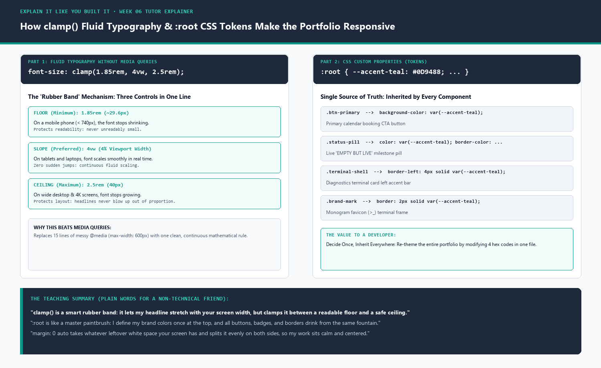

# Week 06 · Explain It Like You Built It

> **Assignment Reference:** [FlyRank AI Fluency — Week 06: Explain Your Build (`#explain-it-like-you-built-it`)](https://aifluency.flyrank.ai/week-06.html#explain-it-like-you-built-it)  
> **Deliverable:** A short plain-words explanation of one real piece of your build, taught to a friend who has never built a website, proving you genuinely own what you shipped and stayed the human in the loop.



---

## 1. The Real Piece of My Build I Chose to Master

From our live portfolio starter site ([`Empty but Live - Ship a Blank Page/index.html`](../Empty%20but%20Live%20-%20Ship%20a%20Blank%20Page/index.html) and root [`index.html`](../index.html)):

```css
/* 1. Global design tokens */
:root {
  --bg-canvas: #F8FAFC;
  --text-ink: #0F172A;
  --surface-slate: #1E293B;
  --accent-teal: #0D9488;
  --font-sans: 'Inter', -apple-system, BlinkMacSystemFont, sans-serif;
  --font-mono: 'JetBrains Mono', monospace;
}

/* 2. Fluid headline typography */
h1 {
  font-size: clamp(1.85rem, 4vw, 2.5rem);
  font-weight: 700;
  line-height: 1.2;
  letter-spacing: -0.025em;
  color: var(--text-ink);
  margin-bottom: 1.25rem;
}

/* 3. Centered responsive column */
.container {
  width: 100%;
  max-width: 780px;
  margin: 0 auto;
  padding: 2.5rem 1.5rem;
}
```

When AI first generated this CSS in Week 4, it worked like magic on my laptop and phone, but I honestly couldn't have explained why `clamp()` had three numbers inside it or why `:root` mattered. I had the AI tutor me on it until I truly understood every line.

Full interactive tutoring transcript: [`tutor-session-transcript.md`](./tutor-session-transcript.md).

---

## 2. The Deliverable: Plain-Words Explainer (Teaching a Friend)

Imagine you’re having coffee with a friend who has never touched a line of code, and you pull out your phone to show them your website. Here is how I explain how this page styles itself and adapts to their screen:

### A. The "Master Paintbrush" Rule (`:root` Variables)
> *"Notice how the 'Book a Call' button, the little 'EMPTY BUT LIVE' status badge, the border around my code block, and my logo all share the exact same teal color?*  
> 
> *A beginner website coder would open their style sheet and type the color code `#0D9488` over and over again on twenty different buttons and borders. If they ever decide next month that teal should be blue, they have to hunt down twenty places and pray they don't miss one.*  
> 
> *Instead, I used a trick called `:root`. Think of `:root` as the master control room at the top of the house. I define `--accent-teal: #0D9488;` once at the very top. Then my buttons, borders, and badges just say: 'Give me whatever color is sitting in the master control room.' If I ever want to re-brand the whole site tomorrow, I change **one word** at the top, and every page on the internet paints itself in that new color instantly."*

### B. The "Smart Rubber Band" Font Rule (`clamp()`)
> *"Now look at the main headline on your phone versus on my laptop. On your phone, it fits comfortably across four lines without spilling off the edge. On my wide laptop screen, it stretches out boldly without looking like giant billboard text.*  
> 
> *Old websites used to do this with clunky 'if-then' rules: 'If the screen is a phone, make the text small; if it's a computer, make it big.' But that caused jarring jumps whenever you turned your phone sideways.*  
> 
> *I used a modern CSS function called `clamp(1.85rem, 4vw, 2.5rem)`. Think of it like a smart rubber band with hard stops at both ends:*  
> 1. *The **Floor (`1.85rem` ≈ 30px):** On a tiny phone screen, the text shrinks, but the floor guarantees it will **never** shrink so small that your eyes have to squint.*  
> 2. *The **Middle Stretch (`4vw` = 4% of screen width):** On normal screens, the font smoothly stretches and shrinks with the screen like a rubber band.*  
> 3. *The **Ceiling (`2.5rem` = 40px):** If someone opens my site on a massive 50-inch TV or 4K monitor, the ceiling kicks in. The text stops growing at 40 pixels so it never blows up out of proportion.*  
> 
> *One single line of math replaces dozens of lines of messy rules and gives a perfectly smooth experience on every device."*

### C. The "Split-The-Difference" Centering Trick (`margin: 0 auto`)
> *"Finally, notice how my content sits right in the middle of the screen with clean margins on both sides?*  
> 
> *In CSS, `max-width: 780px` tells the browser: 'Never let this paragraph get wider than 780 pixels,' because human eyes get tired when a line of text is wider than about 70 characters.  
> 
> *Then, `margin: 0 auto` does something clever: it tells the browser to look at whatever extra whitespace is left over on your screen, divide it exactly in half, and put 50% on the left and 50% on the right. That is why the site stays calmly centered whether you view it in a narrow browser window or maximized on an ultrawide display."*

---

## 3. What I Learned from the AI Tutoring Quiz

During the tutor session, AI asked me two questions to verify I didn't just memorize definitions:

1. **Question 1:** *"What happens to the headline if someone opens the site on a 3840px-wide 4K iMac?"*  
   - **My Takeaway:** 4% of 3840px is a massive 153.6px! Without `clamp()`, a naive responsive formula would break the page with giant letters. The `2.5rem` ceiling is what protects the visual hierarchy from blowing up on big displays.
2. **Question 2:** *"Why not just put the color directly inside `.btn-primary`?"*  
   - **My Takeaway:** Hardcoding values traps styling inside components. Using tokens in `:root` separates *design decisions* from *component implementation*, which is the fundamental difference between amateur CSS and professional design systems.

---

## 4. Evaluation Criteria (Pass / Revise Self-Check)

- [x] **It is a real piece of their build, not a generic tutorial topic:** Analyzed exact CSS lines from [`Empty but Live - Ship a Blank Page/index.html`](../Empty%20but%20Live%20-%20Ship%20a%20Blank%20Page/index.html) and root [`index.html`](../index.html).
- [x] **The explanation is in their own words and actually correct:** Explains `:root` token inheritance, `clamp(min, preferred, max)` mechanics, and `margin: 0 auto` centering using clear real-world metaphors (the master control room, the smart rubber band, splitting leftover whitespace).
- [x] **It demonstrates learning, not pasted output:** Captured interactive tutor session and 2-question comprehension quiz in [`tutor-session-transcript.md`](./tutor-session-transcript.md).
