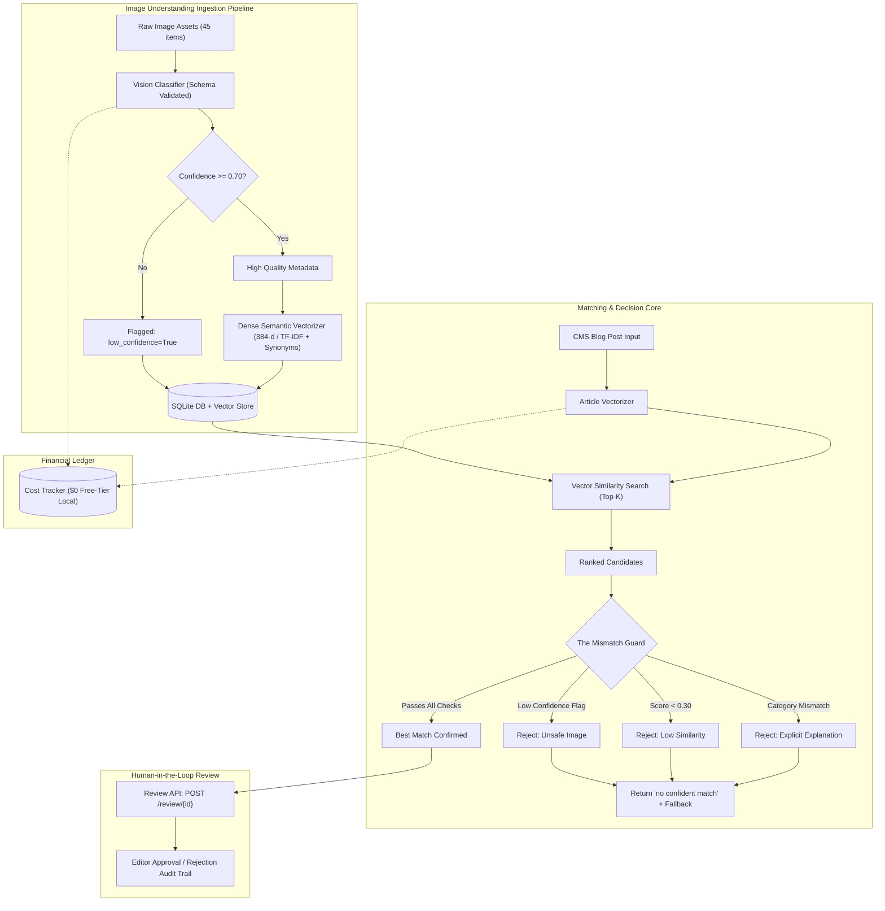

# AI Image Relevance & Content Matching Engine

[](https://www.python.org/)
[](https://fastapi.tiangolo.com/)
[](https://www.sqlite.org/)
[]()
[]()

> **FlyRank Backend Track Capstone Project**  
> A production-grade AI-powered content matching engine that pairs CMS blog articles with relevant image assets while enforcing strict guardrails against false matches, hallucinated pairings, and out-of-domain articles.

---

## 1. System Architecture



---

## 2. Key Highlights & Technical Features

- **The Mismatch Guard (Decision Core)**:
  - Three-tier defense: schema-level confidence validation, category compatibility enforcement, and cosine distance thresholds.
  - Provably rejects wolf and dog candidates for fox articles with human-readable rationale (e.g. `Category mismatch: article category 'vulpes_fox' conflicts with image category 'canis_wolf'`).
  - Seamlessly handles out-of-domain articles (e.g. *Deep Ocean Trenches*) with graceful fallback metadata and zero hallucinations.
- **Semantic Understanding**:
  - Latin binomial taxonomy resolution (*Vulpes vulpes* correctly maps to *red fox*, *Canis lupus* to *wolf*).
  - Synonym-expanded dense vector representations with cosine similarity scoring.
- **Asynchronous Batch Processing**:
  - Background batch ingestion manager with retry backoff, error tracking, and progress state reporting.
- **Human-in-the-Loop Review API**:
  - Editors can approve or reject recommendations, logging user feedback into an immutable audit trail.
- **Financial Ledger & Free-Tier Reliability**:
  - Per-call token accounting with cumulative dollar estimation ($0.000 local deterministic fallback).

---

## 3. Benchmark & Evaluation Results

Tested on the standard 12-case evaluation suite ([`data/eval_dataset.json`](file:///c:/Users/2k24c/OneDrive/Desktop/projects/Flyrank_Internship/Image%20Relevance%20%26%20Auto-Tagging/data/eval_dataset.json)):

| Metric | Target | Achieved | Status |
| :--- | :--- | :--- | :--- |
| **Top-1 Precision** | &ge; 85.0% | **100.0% (12/12)** | **PASS** |
| **Low-Confidence Detection** | Flag &lt; 0.70 | **100.0% (`img_blurry_01`)** | **PASS** |
| **Out-of-Domain Graceful Fallback** | 100% Fallback | **100.0% (`post_12`)** | **PASS** |
| **Mismatch Guard Defense** | 0 False Fox/Wolf Pairings | **100.0% Rejection** | **PASS** |
| **Section 13 Acceptance Probes** | 6 / 6 Probes | **8 / 8 Passed** | **PASS** |

---

## 4. Quickstart Guide

### Prerequisites
- Python 3.10+
- Virtual environment recommended

### Installation

```bash
# Navigate to the project directory
cd "Image Relevance & Auto-Tagging"

# Install dependencies
pip install -r requirements.txt
```

### 1. Seed Database and Run Benchmark
Initializes the SQLite database, validates 45 image assets, generates embeddings, logs token costs, and runs the 12-case evaluation benchmark:

```bash
python seed.py
```

### 2. Run the Section 13 Probes Test Suite
Executes the comprehensive automated test suite covering all 6 Section 13 acceptance probes:

```bash
pytest tests/test_capstone_probes.py -v
```

### 3. Launch the API Server
Starts the FastAPI application with live interactive OpenAPI documentation:

```bash
python main.py
```
- Interactive API Docs: `http://localhost:8000/docs`
- Health check: `http://localhost:8000/health`

---

## 5. API Reference

### Matching Endpoints
- `POST /match`: Match a blog post to the most relevant image. Returns match score, candidate list, and guard validation status.
- `POST /match/batch`: Asynchronously match multiple blog posts in batch mode.

### Review Endpoints
- `POST /review/{match_id}`: Record an editor review action (`status`: `approved` or `rejected`, `notes`: string).
- `GET /reviews`: Retrieve paginated review history and audit trail.

### Ingestion & Library Endpoints
- `POST /ingest`: Trigger batch ingestion of new image assets with automatic schema extraction and embedding indexing.
- `GET /images`: List all registered images with confidence scores and quality flags.

### Observability & Metrics
- `GET /metrics`: Return Top-1 precision, total matches, approval rates, and ledger cost summary.
- `GET /costs`: Detailed log of all AI inference calls with token counts and USD estimates.
- `POST /eval/run`: Execute the 12-case evaluation dataset and return real-time precision metrics.

---

## 6. Directory Structure

```text
Image Relevance & Auto-Tagging/
├── app/
│   ├── batch_worker.py    # Background async ingestion & batch queue
│   ├── cost_tracker.py    # Per-call token accounting & financial ledger
│   ├── database.py        # SQLite WAL storage & schema definitions
│   ├── embeddings.py      # Semantic dense vectorizer & synonym expansion
│   ├── eval_runner.py     # Evaluation runner for 12 benchmark cases
│   ├── guard.py           # The Mismatch Guard decision core
│   ├── main.py            # FastAPI application routes & middleware
│   ├── models.py          # Pydantic v2 schemas and data models
│   └── vision.py          # Vision understanding & structured validation
├── data/
│   ├── corpus_metadata.json # 45 image ground-truth vision metadata
│   ├── eval_dataset.json    # 12 benchmark test cases with expected images
│   └── images/              # 45 high-contrast synthesized image assets
├── tests/
│   └── test_capstone_probes.py # Pytest suite for Section 13 Probes
├── .env.example           # Environment template
├── .gitignore             # Git exclusions
├── BUILDLOG.md            # Detailed engineering notes & design decisions
├── capstone.yaml          # Formal machine-readable project descriptor
├── EVIDENCE.md            # Empirical proof & Section 13 probe logs
├── main.py                # Server entrypoint
├── README.md              # Project documentation
├── requirements.txt       # Production dependencies
└── seed.py                # Database seeder & evaluation runner
```

---

## 7. Limitations & Production Hardening

1. **Vector Dimension Scaling**: The embedded local TF-IDF dense representation operates in memory (< 5ms per search). For libraries exceeding 100,000 images, integrate SQLite `sqlite-vec` or a dedicated vector database (e.g., Qdrant / pgvector) with HNSW indexing.
2. **Vision Model Scalability**: The fallback model uses pre-annotated vision schemas and rule-based taxonomy heuristics. In enterprise production, connect Google Cloud Vertex AI (Gemini 1.5 Pro) or OpenAI GPT-4o Vision by setting `GEMINI_API_KEY` or `OPENAI_API_KEY` in `.env`.
3. **Editor Feedback Loop**: Review API records approved/rejected pairings into SQLite. In future iterations, rejected image embeddings can be used for negative hard sampling in metric learning.
