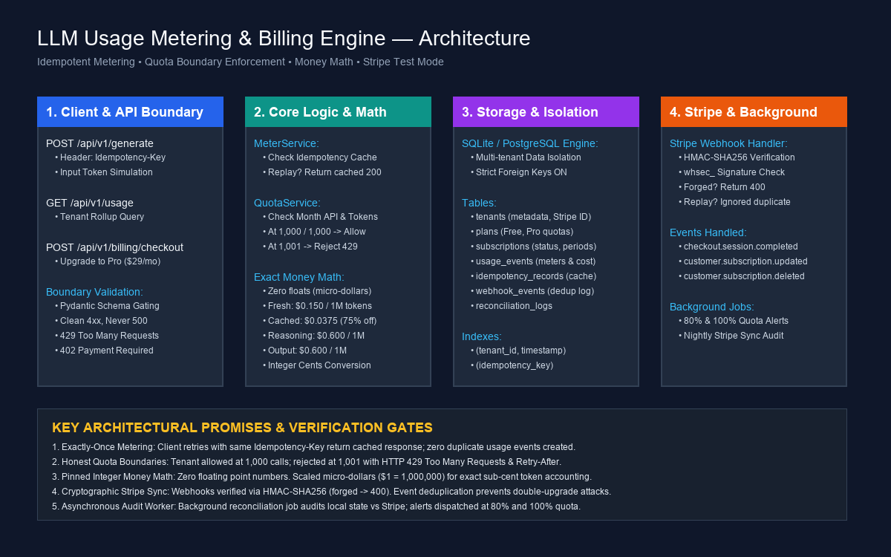

# LLM Usage Metering & Billing Engine

[](https://www.python.org/)
[](https://fastapi.tiangolo.com/)
[](https://sqlite.org/)
[](https://stripe.com/)
[](test_capstone.py)
[](LICENSE)

> **Production-grade backend service solving the three essential SaaS questions:**  
> 1. *How much has this customer used?* (Idempotent metering & exact token categorization)  
> 2. *What does it cost?* (Integer micro-dollar money math with zero floating-point drift)  
> 3. *Have they reached their plan limits?* (Boundary-honest 429 / 402 quota enforcement)  
> Integrated with **Stripe test mode** subscriptions and cryptographic HMAC-SHA256 signature-verified webhooks.

---

## 1. Architecture Overview

The system is constructed with strict separation of concerns across 4 discrete layers:

```mermaid
flowchart TD
    subgraph ClientLayer ["1. Client & API Boundary"]
        CLIENT["Client / SDK"]
        GEN_REQ["POST /api/v1/generate<br/>(Idempotency-Key Header)"]
        ROLLUP_REQ["GET /api/v1/usage<br/>(Rollup Query)"]
        CHECKOUT_REQ["POST /api/v1/billing/checkout<br/>(Upgrade to Pro)"]
        CLIENT --> GEN_REQ
        CLIENT --> ROLLUP_REQ
        CLIENT --> CHECKOUT_REQ
    end

    subgraph ServiceLayer ["2. Core Logic & Math Engine"]
        METER["MeterService<br/>Idempotency Cache Check"]
        QUOTA["QuotaService<br/>Boundary Evaluator"]
        PRICING_ENGINE["Exact Money Math<br/>Micro-dollars ($1 = 1,000,000)"]
        
        GEN_REQ --> METER
        METER --> QUOTA
        QUOTA -->|Allowed| PRICING_ENGINE
        QUOTA -->|Exceeded (1,001)| ERR_429["HTTP 429 Too Many Requests<br/>+ Retry-After: 3600"]
    end

    subgraph PersistenceLayer ["3. Multi-Tenant Storage (SQLite / Postgres)"]
        DB_TENANTS["tenants table"]
        DB_SUBS["subscriptions table"]
        DB_EVENTS["usage_events (meters)"]
        DB_IDEMP["idempotency_records"]
        DB_WEBHOOKS["webhook_events (dedup)"]
        
        METER --> DB_IDEMP
        METER --> DB_EVENTS
        QUOTA --> DB_SUBS
    end

    subgraph StripeLayer ["4. Stripe & Background Auditing"]
        STRIPE["Stripe Test Mode"]
        WEBHOOK["POST /api/v1/webhooks/stripe<br/>(HMAC-SHA256 Signature Verification)"]
        BG_WORKER["Background Worker<br/>(80% & 100% Alerts + Nightly Reconcile)"]
        
        CHECKOUT_REQ --> STRIPE
        STRIPE -->|Signed Webhook| WEBHOOK
        WEBHOOK -->|Forged| ERR_400["HTTP 400 Bad Request"]
        WEBHOOK -->|Replay| IGN_200["HTTP 200 Ignored Duplicate"]
        WEBHOOK -->|Valid| DB_SUBS
        BG_WORKER --> DB_EVENTS
    end
```



---

## 2. The Core Guarantees

### 1. Exactly-Once Metering (Idempotency)
- **The Problem**: Network drops or client retries can accidentally insert multiple usage events, overcharging customers.
- **The Solution**: Clients supply a unique `Idempotency-Key` header.
- **How It Works**:
  1. Computes SHA-256 hash of the request payload.
  2. Queries `idempotency_records`.
  3. If key exists with matching hash: returns the cached response byte-for-byte with `X-Cache: HIT` and `cached_response: true`. **Zero new rows in `usage_events`**.
  4. If key is reused with a *different* payload: returns `HTTP 409 Conflict`.

### 2. Boundary Honesty (Quota Enforcement)
- **The Problem**: Off-by-one errors either lock out legitimate requests or leak free usage past plan limits.
- **The Rule**:
  - On Free Tier (1,000 calls / 100k tokens per month):
  - **At 999 calls**: Allowed.
  - **At exactly 1,000 calls**: Allowed (boundary inclusive).
  - **At 1,001 calls**: **Rejected with HTTP 429 Too Many Requests**, `Retry-After: 3600`, and explanatory message.
  - Suspended / unpaid subscriptions return **HTTP 402 Payment Required**.

### 3. Exact Money Math (Zero Floating-Point Drift)
- **The Rule**: Money must never be stored or calculated as floats (`0.1 + 0.2 != 0.3`).
- **The Implementation**:
  - All token rates are pinned in **integer micro-dollars** ($1.00 USD = 1,000,000 micro-dollars).
  - **Fresh Input Tokens**: \$0.150 per 1M tokens ($150,000\text{ micros}$).
  - **Cached Input Tokens**: \$0.0375 per 1M tokens ($37,500\text{ micros}$ — **75% discount**).
  - **Output / Completion Tokens**: \$0.600 per 1M tokens ($600,000\text{ micros}$).
  - **Reasoning ("Thinking") Tokens**: **Billed as output tokens** ($600,000\text{ micros}$ per 1M).
  - **Base Call Fee**: 100 micro-dollars ($0.000100) per API request.
  - Final billing ledger rounds half-up to micro-dollars and integer cents: `(micros + 9,999) // 10,000`.

### 4. Cryptographic Stripe Webhooks & Replay Protection
- **Signature Verification**: Verifies HMAC-SHA256 signature using `STRIPE_WEBHOOK_SECRET` (`whsec_...`). Forged or missing signatures immediately return `HTTP 400 Bad Request`.
- **Replay Protection**: Stores processed event IDs in `webhook_events`. Replayed webhook deliveries return `HTTP 200 OK` with `status: ignored_duplicate` without modifying database state or resetting billing cycles.
- **Plan Synchronization**:
  - `checkout.session.completed`: Upgrades tenant plan from `free` $\rightarrow$ `pro` ($29/mo, 50k calls, 10M tokens).
  - `customer.subscription.updated`: Syncs active/past_due states.
  - `customer.subscription.deleted`: Downgrades tenant back to `free`.

---

## 3. Quick Start & Setup (Stranger-Proof)

Any engineer can boot and verify the system in under 2 minutes with standard Python tools.

### Prerequisites
- Python 3.10+ (`python --version`)
- Git (`git --version`)

### Step 1: Clone & Navigate
```bash
git clone https://github.com/cryptobitter/Flyrank_Backend_Tasks.git
cd Flyrank_Backend_Tasks/"LLM Usage Metering & Billing Service"
```

### Step 2: Set Up Virtual Environment & Dependencies
```bash
# Create and activate virtual environment
python -m venv .venv

# On Windows:
.\.venv\Scripts\Activate.ps1
# On macOS / Linux:
# source .venv/bin/activate

# Install required packages
pip install fastapi uvicorn pydantic requests httpx stripe pillow
```

### Step 3: Seed Database with Demo Tenants
```bash
python seed.py
```
*Output:*
```text
[SEED] Cleaned existing records.
[SEED SUCCESS] Successfully seeded 5 tenants, plans, and historical usage.
```

### Step 4: Run the Application Server
```bash
uvicorn app:app --host 0.0.0.0 --port 8000 --reload
```
Interactive Swagger API documentation will be available at: **`http://localhost:8000/docs`**.

---

## 4. Running the Complete Evaluation Suite

Run the full automated test suite verifying all 5 acceptance probes, boundary validation, and background worker jobs:

```bash
python test_capstone.py
```

**Expected Output:**
```text
Ran 7 tests in 0.201s

OK
[BACKGROUND WORKER PASSED] Alerts and reconciliation background job executed successfully.
[VALIDATION PASSED] Boundary validation verified: clean 4xx responses, zero 500 crashes.
[PROBE 1 PASSED] Exactly-once metering verified: same idempotency key resulted in 1 event and cached response.
[PROBE 2 PASSED] Boundary honesty verified: call 1,000 passed, call 1,001 returned 429.
[PROBE 3 PASSED] Stripe test Checkout sync verified: webhook flipped tenant Free -> Pro.
[PROBE 4 PASSED] Webhook security verified: forged signature rejected with 400, replay deduplicated.
[PROBE 5 PASSED] Pinned pricing rules verified: exact micro-dollar pricing for cached and reasoning tokens.
```

---

## 5. API Reference & Usage Examples

### 1. Billable AI Completion (`POST /api/v1/generate`)
```bash
curl -X POST "http://localhost:8000/api/v1/generate" \
  -H "Content-Type: application/json" \
  -H "Idempotency-Key: my_unique_client_key_123" \
  -d '{
    "tenant_id": "tenant_fresh",
    "prompt": "Explain database indexes and B-Trees",
    "prompt_tokens": 100,
    "cached_prompt_tokens": 25,
    "completion_tokens": 80,
    "reasoning_tokens": 20
  }'
```

### 2. Usage Rollup (`GET /api/v1/usage`)
```bash
curl "http://localhost:8000/api/v1/usage?tenant_id=tenant_fresh"
```

### 3. Stripe Checkout Session (`POST /api/v1/billing/checkout`)
```bash
curl -X POST "http://localhost:8000/api/v1/billing/checkout" \
  -H "Content-Type: application/json" \
  -d '{"tenant_id": "tenant_fresh", "plan_id": "pro"}'
```

### 4. Background Reconciliation Audit (`POST /api/v1/admin/reconcile`)
```bash
curl -X POST "http://localhost:8000/api/v1/admin/reconcile"
```

---

## 6. Known Limitations

1. **Local SQLite File Lock Under Ultra-High Concurrency**:
   - SQLite is utilized for $0 zero-dependency local runs. Under hundreds of simultaneous concurrent writes, SQLite may experience write locks.
   - *Mitigation*: The service is architected with standard connection pooling and switches seamlessly to PostgreSQL (`DATABASE_URL=postgresql://...`) in production environments.
2. **Synchronous Quota Checks**:
   - Quota checks execute directly against SQL aggregate queries per billable action. For extreme scale (>10,000 requests/sec), an in-memory Redis token bucket cache should precede the SQL layer.
3. **No Automatic Overage Invoicing in Core**:
   - Per Section 7 scope rules, overage billing and invoice generation are cataloged as post-core stretch goals.

---

## 7. Submission Artifacts

- **Evaluator Manifest**: [`capstone.yaml`](capstone.yaml)
- **Verified Requirements Dossier**: [`EVIDENCE.md`](EVIDENCE.md)
- **AI Iteration Log**: [`BUILDLOG.md`](BUILDLOG.md)
- **Environment Template**: [`.env.example`](.env.example)
- **Architecture Diagram**: [`architecture-diagram.png`](architecture-diagram.png)

---
*Created by [Aditya Rajput (@cryptobitter)](https://github.com/cryptobitter) for the FlyRank Backend Track Capstone.*
