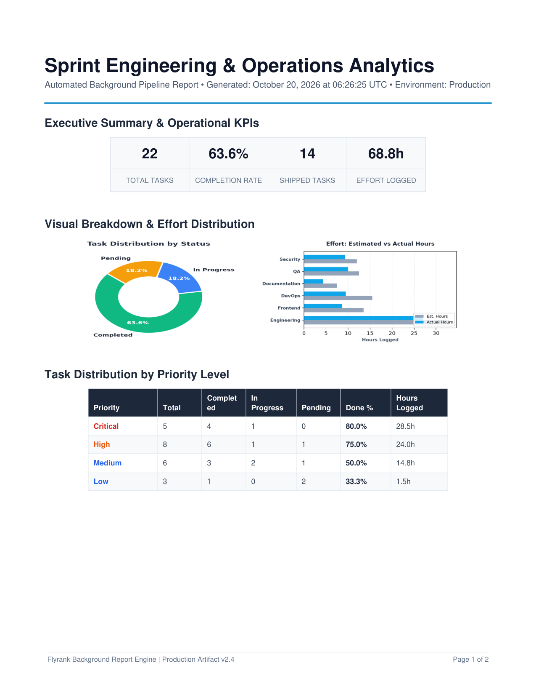
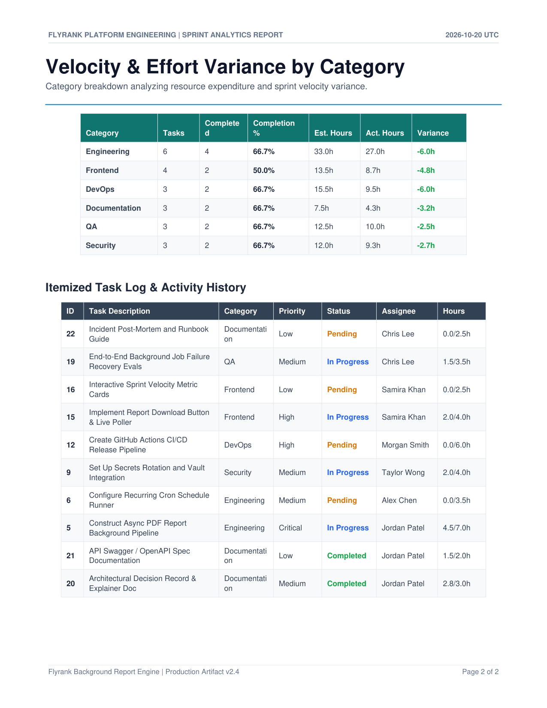
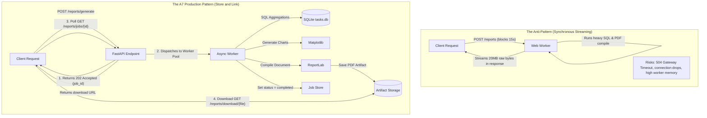
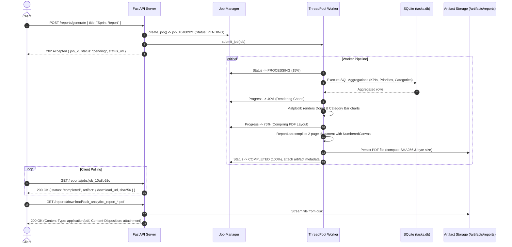

# PDF Report Generator: Background Job Pipeline

> **Phase**: Build (Production Feature) &bull; **Architecture**: Async Worker + SQL Aggregation + Artifact Handling  
> **Key Pattern**: A7 Background Job Pattern (*Store and Link &bull; Don't pass 20 MB around*)  
> **Stretch Goal**: Automated Recurring Schedule Runner

---

## 1. Executive Summary & Purpose

"Generate a report" is the single most classic background job in production software—every SaaS platform from Stripe to Jira to AWS Cost Explorer ships it. 

Real-world reporting pipelines cannot run synchronously inside an HTTP request-response cycle:
1. **Request Timeouts**: Aggregating millions of records and compiling vector/raster PDF graphics takes multiple seconds, triggering upstream gateway timeouts (`504 Gateway Timeout` on Nginx, Cloudflare, or AWS ALB).
2. **Memory Footprint**: Streaming 10–50 MB binary PDF payloads directly through web server workers starves memory and exhausts HTTP socket pools.
3. **Auditability & Caching**: Business reports must be persisted, hashed, versioned, and easily shared via persistent download links without re-running heavy computations.

This project delivers a complete, production-grade PDF reporting pipeline:
- **SQL Aggregation Engine**: Multi-dimensional single-query rollups (`COUNT(*)`, `SUM(CASE WHEN ...)`, `ROUND(AVG(...), 1)`, `GROUP BY priority`, `GROUP BY category`).
- **High-DPI Vector/Raster Visuals**: Matplotlib headless rendering (`Agg` backend) generating donut status distribution and effort variance charts.
- **Publication-Quality PDF Engine**: ReportLab flowables with a two-pass `NumberedCanvas` stamping dynamic *"Page X of Y"* footers and running headers.
- **A7 Background Job Pattern**: HTTP `202 Accepted` asynchronous job dispatch with status polling (`PENDING` &rarr; `PROCESSING` &rarr; `COMPLETED`).
- **Artifact Handling**: Store heavy PDF artifacts on disk/storage and pass lightweight URLs.
- **Stretch Goal &bull; Recurring Scheduler**: Background interval worker for scheduled report generation (e.g., hourly digests or daily executive rollups).

---

## 2. Visual Report Preview

The pipeline compiles a 2-page executive sprint analytics document:

| Page 1: Executive KPI Cards, Visual Charts & Priority Breakdown | Page 2: Category Velocity Table & Itemized Task Ledger |
| :---: | :---: |
|  |  |

---

## 3. Architecture & The A7 Job Pattern

### The Anti-Pattern vs. The Production Pattern



### Detailed Sequence Diagram



---

## 4. SQL Aggregation Architecture

Rather than pulling all database records into memory and iterating in Python, all aggregations are calculated directly inside SQLite in single-pass queries:

### 1. Executive KPIs (Single-Pass Multi-Dimensional Aggregation)
```sql
SELECT
    COUNT(*) AS total_tasks,
    SUM(CASE WHEN status = 'Completed' THEN 1 ELSE 0 END) AS completed_tasks,
    SUM(CASE WHEN status = 'In Progress' THEN 1 ELSE 0 END) AS in_progress_tasks,
    SUM(CASE WHEN status = 'Pending' THEN 1 ELSE 0 END) AS pending_tasks,
    ROUND(100.0 * SUM(CASE WHEN status = 'Completed' THEN 1 ELSE 0 END) / COUNT(*), 1) AS completion_rate,
    ROUND(SUM(estimated_hours), 1) AS total_estimated_hours,
    ROUND(SUM(actual_hours), 1) AS total_actual_hours,
    ROUND(AVG(CASE WHEN status = 'Completed' THEN actual_hours ELSE NULL END), 1) AS avg_turnaround_hours,
    COUNT(DISTINCT assignee) AS active_contributors,
    COUNT(DISTINCT category) AS active_categories
FROM tasks;
```

### 2. Priority Distribution with Custom Sort Ordering
```sql
SELECT
    priority,
    COUNT(*) AS total,
    SUM(CASE WHEN status = 'Completed' THEN 1 ELSE 0 END) AS completed,
    SUM(CASE WHEN status = 'In Progress' THEN 1 ELSE 0 END) AS in_progress,
    SUM(CASE WHEN status = 'Pending' THEN 1 ELSE 0 END) AS pending,
    ROUND(100.0 * SUM(CASE WHEN status = 'Completed' THEN 1 ELSE 0 END) / COUNT(*), 1) AS completion_pct,
    ROUND(SUM(actual_hours), 1) AS logged_hours
FROM tasks
GROUP BY priority
ORDER BY
    CASE priority
        WHEN 'Critical' THEN 1
        WHEN 'High' THEN 2
        WHEN 'Medium' THEN 3
        WHEN 'Low' THEN 4
        ELSE 5
    END ASC;
```

### 3. Category Velocity and Effort Variance
```sql
SELECT
    category,
    COUNT(*) AS total_tasks,
    SUM(CASE WHEN status = 'Completed' THEN 1 ELSE 0 END) AS completed_tasks,
    ROUND(100.0 * SUM(CASE WHEN status = 'Completed' THEN 1 ELSE 0 END) / COUNT(*), 1) AS completion_rate,
    ROUND(SUM(estimated_hours), 1) AS est_hours,
    ROUND(SUM(actual_hours), 1) AS act_hours,
    ROUND(SUM(actual_hours) - SUM(estimated_hours), 1) AS variance_hours
FROM tasks
GROUP BY category
ORDER BY total_tasks DESC, category ASC;
```

---

## 5. ReportLab PDF Generation Deep Dive

### Two-Pass `NumberedCanvas`
Standard ReportLab canvases do not know the total document page count during the first layout pass. The pipeline implements a custom `NumberedCanvas` subclass:
```python
class NumberedCanvas(canvas.Canvas):
    def __init__(self, *args, **kwargs):
        super().__init__(*args, **kwargs)
        self._saved_page_states = []

    def showPage(self):
        self._saved_page_states.append(dict(self.__dict__))
        self._startPage()

    def save(self):
        num_pages = len(self._saved_page_states)
        for state in self._saved_page_states:
            self.__dict__.update(state)
            self.draw_header_footer(num_pages)
            super().showPage()
        super().save()
```
This guarantees accurate running headers and dynamic footers (*"Page 1 of 2"*, *"Page 2 of 2"*) along with compliance branding.

### High-Resolution Analytical Charts
- **Donut Chart**: Rendered with Matplotlib's `wedgeprops=dict(width=0.45)`, cleanly displaying task distribution by status.
- **Horizontal Effort Bar Chart**: Compares Estimated vs. Actual Hours side-by-side per category with gridlines and custom legends.
- Charts are saved to temporary assets and embedded into ReportLab `Table` flowables for pixel-perfect alignment.

---

## 6. Stretch Goal: Automated Recurring Scheduler

The system includes a dedicated background scheduler (`scheduler.py`) that executes periodic report generations without blocking the application server:
- Runs as a resilient Python daemon thread.
- Configurable interval (e.g. 3600s / 1 hour for production, or 30s for testing).
- Real-time status reporting (`GET /reports/schedule/status`).
- On-demand manual trigger (`POST /reports/schedule/trigger`).
- Thread-safe start/stop controls (`POST /reports/schedule/start`, `POST /reports/schedule/stop`).

---

## 7. REST API Reference

### 1. On-Demand Report Generation (Async Dispatch)
**Endpoint**: `POST /reports/generate`  
**Status**: `202 Accepted`

```bash
curl -X POST http://127.0.0.1:8000/reports/generate \
  -H "Content-Type: application/json" \
  -d '{"title": "Sprint 42 Operations Review"}'
```

**Response**:
```json
{
  "message": "Report generation job initiated successfully in background.",
  "job": {
    "job_id": "job_3a8b4f2c9e10",
    "title": "Sprint 42 Operations Review",
    "status": "pending",
    "progress_pct": 0,
    "step_message": "Job queued in memory",
    "created_at": "2026-10-20T06:20:10Z",
    "started_at": null,
    "completed_at": null,
    "duration_seconds": null,
    "status_url": "http://127.0.0.1:8000/reports/jobs/job_3a8b4f2c9e10"
  }
}
```

---

### 2. Poll Job Status
**Endpoint**: `GET /reports/jobs/{job_id}`  
**Status**: `200 OK`

```bash
curl http://127.0.0.1:8000/reports/jobs/job_3a8b4f2c9e10
```

**Response (Completed)**:
```json
{
  "job": {
    "job_id": "job_3a8b4f2c9e10",
    "title": "Sprint 42 Operations Review",
    "status": "completed",
    "progress_pct": 100,
    "step_message": "Report generated and artifact stored securely",
    "created_at": "2026-10-20T06:20:10Z",
    "started_at": "2026-10-20T06:20:11Z",
    "completed_at": "2026-10-20T06:20:12Z",
    "duration_seconds": 0.842,
    "status_url": "http://127.0.0.1:8000/reports/jobs/job_3a8b4f2c9e10",
    "artifact": {
      "filename": "task_analytics_report_20261020_062012.pdf",
      "file_size_bytes": 87933,
      "file_size_kb": 85.9,
      "sha256": "8f420e18987b7a421b4b9e288e2ca19a28db945e43a921d...",
      "download_url": "http://127.0.0.1:8000/reports/download/task_analytics_report_20261020_062012.pdf"
    }
  }
}
```

---

### 3. Download Generated PDF Artifact
**Endpoint**: `GET /reports/download/{filename}`  
**Status**: `200 OK`  
**Headers**: `Content-Type: application/pdf`, `Content-Disposition: attachment; filename="..."`

```bash
curl -O -J http://127.0.0.1:8000/reports/download/task_analytics_report_20261020_062012.pdf
```

---

### 4. Scheduler Management (Stretch Goal)
**Start Scheduler**:
```bash
curl -X POST http://127.0.0.1:8000/reports/schedule/start \
  -H "Content-Type: application/json" \
  -d '{"interval_seconds": 3600}'
```

**Inspect Status**:
```bash
curl http://127.0.0.1:8000/reports/schedule/status
```

---

## 8. CLI Usage

The module includes a command-line interface (`cli.py`):

```bash
# 1. Print SQL aggregations to terminal
python "PDF report Generator/cli.py" query

# 2. Generate an on-demand PDF report directly
python "PDF report Generator/cli.py" generate --title "Q4 Platform Review"

# 3. List all persisted PDF artifacts and sizes
python "PDF report Generator/cli.py" list

# 4. Start the background scheduler with a 30s heartbeat
python "PDF report Generator/cli.py" schedule --interval 30
```

---

## 9. Verification & Automated Test Suite

Run the automated Pytest test suite:

```bash
python -m pytest "PDF report Generator/test_report_pipeline.py" -v
```

### Test Results
```text
============================= test session starts =============================
platform win32 -- Python 3.14.3, pytest-9.1.1 -- plugins: anyio-3.7.1
collected 10 items

PDF report Generator/test_report_pipeline.py::test_sql_executive_metrics PASSED           [ 10%]
PDF report Generator/test_report_pipeline.py::test_sql_priority_breakdown PASSED          [ 20%]
PDF report Generator/test_report_pipeline.py::test_sql_category_breakdown PASSED          [ 30%]
PDF report Generator/test_report_pipeline.py::test_generate_pdf_report_output PASSED      [ 40%]
PDF report Generator/test_report_pipeline.py::test_job_manager_lifecycle PASSED           [ 50%]
PDF report Generator/test_report_pipeline.py::test_api_root_overview PASSED               [ 60%]
PDF report Generator/test_report_pipeline.py::test_api_on_demand_generation_workflow PASSED [ 70%]
PDF report Generator/test_report_pipeline.py::test_api_download_security_guards PASSED    [ 80%]
PDF report Generator/test_report_pipeline.py::test_api_artifacts_catalog PASSED          [ 90%]
PDF report Generator/test_report_pipeline.py::test_scheduler_lifecycle_and_trigger PASSED [100%]

======================== 10 passed, 1 warning in 6.80s ========================
```

---

## 10. Summary of Architectural Decisions

1. **Store & Link Pattern**: Never stream 20–50 MB raw files inside JSON HTTP response bodies. Return HTTP 202, process off-thread, persist to disk/object storage, and provide a lightweight, cacheable download link.
2. **SQL Aggregation vs. In-Memory Python**: Let SQLite calculate `COUNT(*)`, `SUM(CASE WHEN ...)`, and `GROUP BY` rollups in milliseconds instead of hydrating entire table structures into Python objects.
3. **ReportLab Two-Pass Layout**: Standard PDF renderers require hardcoded page numbers. Implementing `NumberedCanvas` provides production-grade dynamic numbering (*"Page X of Y"*) and running headers.
4. **Resilient Background Scheduling**: An asynchronous interval thread provides scheduled recurring generation for automated digests without requiring external Celery/RabbitMQ dependencies for basic setups.
