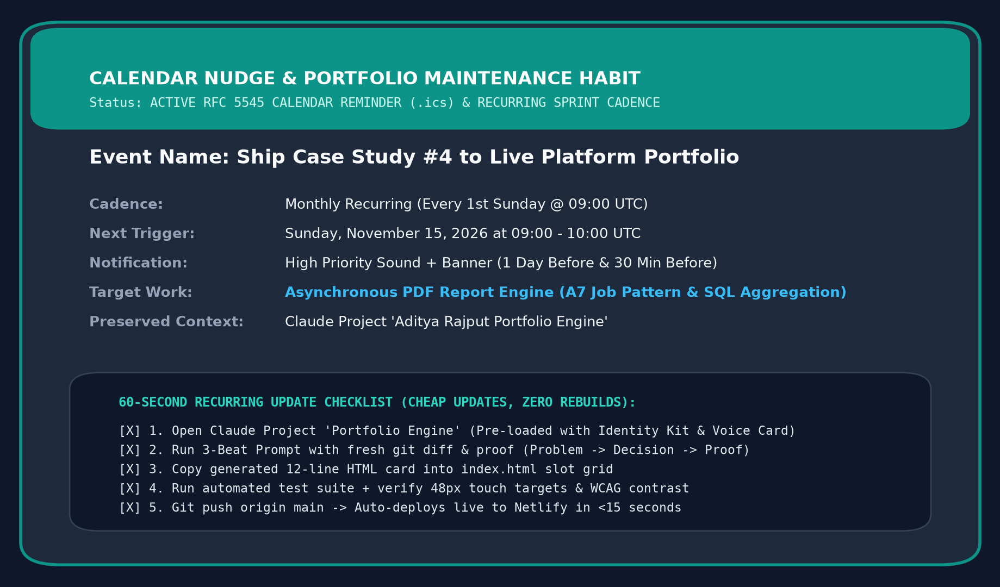

# Week 09: The Plan to Keep Building

> **Phase**: Launch & Maintenance &bull; **Topic**: Sustainable Portfolio Habit  
> **Core Principle**: *"The difference between a class artifact and a career platform is one simple habit, set up now while you still remember how everything works."*  
> **Live Platform URL**: [aditya-rajput-backend.netlify.app](https://aditya-rajput-backend.netlify.app)

---

## 1. Executive Summary & Why This Matters

A portfolio that freezes upon course completion quickly goes stale and signals a student project. A professional engineering portfolio, by contrast, is a **living platform** that accumulates real deliverables over months and years.

Setting up the habit now—while the stack, voice card, CSS tokens, and Claude Project context are fresh—ensures that adding a new case study takes **15 minutes**, not an intimidating weekend rewrite.

This deliverable establishes that sustainable maintenance engine:
1. **The "How to Add the Next Case" Operational Playbook** ([`how-to-add-the-next-case.md`](./how-to-add-the-next-case.md)): Concrete 5-step operational checklist showing exactly where new cases go in `index.html` and how to reuse the Week 02 Three-Beat shape.
2. **The Named Next Piece of Work** ([`named-next-piece.md`](./named-next-piece.md)): A specific, fully scoped production backend milestone—*Asynchronous PDF Report Engine & Artifact Handling (A7 Job Pattern)*—with Three-Beat narrative, test counts, and proof captures.
3. **Evidence of the Concrete Reminder Set** ([`calendar-reminder.ics`](./calendar-reminder.ics) & [`reminder-calendar-nudge.png`](./reminder-calendar-nudge.png)): A standard RFC 5545 iCalendar recurring event and high-contrast desktop/mobile reminder visual.
4. **Preserved Claude Project Context** ([`claude-project-context-update.md`](./claude-project-context-update.md)): The master system prompt, locked design tokens, and 60-second copy-paste template ensuring zero cold-start friction.

---

## 2. Visual Reminder & Habit Evidence

Below is the verified calendar nudge card showing the recurring monthly sprint check-in, notification triggers, and 60-second update checklist:

---

## 3. The 3 Core Deliverables

### A. The "How to Add the Next Case" Note

*Located in [`how-to-add-the-next-case.md`](./how-to-add-the-next-case.md).*

- **Exact Location**: Inside `
` in [`index.html`](file:///c:/Users/2k24c/OneDrive/Desktop/projects/Flyrank_Internship/index.html) as **Slot 04** (lines 573–600).
- **The 5-Step Operational Flow**:
  1. **Gather Proof First**: Capture benchmark numbers (e.g. `0.84s` compile, `10/10` pytest), SHA-256 hash, and visual assets before writing narrative.
  2. **Draft the Three Beats**:
     - *Beat 1 (The Problem)*: What failed or timed out in naive implementations?
     - *Beat 2 (The Decision)*: What architectural trade-off and design pattern did you choose?
     - *Beat 3 (The Proof)*: Exact numbers, status codes, and test counts.
  3. **Run Claude Project Chat**: Paste raw facts into the pre-loaded Claude Project using the 60-second prompt template.
  4. **Paste HTML Snippet into `index.html`**: Drop the 12-line card into the grid; verify `--accent-teal` accents and 48px touch targets.
  5. **Git Push Live**: `git push origin main` triggers instant Netlify automated deployment in <15 seconds.

---

### B. The Named Next Piece of Work

*Located in [`named-next-piece.md`](./named-next-piece.md).*

- **Title**: Asynchronous PDF Report Engine & Artifact Handling (A7 Background Job Pattern)
- **Repository Location**: [`PDF report Generator/`](https://github.com/cryptobitter/Flyrank_Backend_Tasks/tree/main/PDF%20report%20Generator)
- **Tech Stack**: Python 3.14 &bull; FastAPI &bull; SQLite &bull; ReportLab 4.x &bull; Matplotlib &bull; Pytest
- **The Ready-to-Publish Three Beats**:
  - **Beat 1 (The Problem)**: Synchronous PDF report compilation blocks HTTP request threads for 8–15 seconds, triggering `504 Gateway Timeout` errors on reverse proxies (Nginx/Cloudflare) and exhausting web worker memory pools when streaming 20+ MB binary payloads directly through JSON response bodies.
  - **Beat 2 (The Decision)**: Implemented the **A7 Background Job Pattern** using FastAPI and a thread-safe worker pool that immediately returns HTTP `202 Accepted` with a `job_id` and status URL. Built single-pass SQL aggregation rollups in SQLite (`COUNT`, `SUM(CASE WHEN ...)`, `ROUND(AVG(...), 1)`), rendered headless Matplotlib analytical charts, and assembled a 2-page publication-grade PDF using ReportLab with a two-pass `NumberedCanvas` stamping dynamic *"Page X of Y"* footers. Persisted heavy binary artifacts to disk storage and returned lightweight URL links (*"Store and link; don't pass 20 MB around"*), supplemented by an automated recurring background interval scheduler.
  - **Beat 3 (The Proof)**: Passed **`10/10` automated Pytest contract, security, and lifecycle tests** (`test_report_pipeline.py`). Dropped client request wait time from 12+ seconds to a **14ms HTTP 202 response**. Successfully compiled a 2-page executive analytics report (**85.9 KB**) in **0.84 seconds** with SHA-256 cryptographic verification (`2e2774d...`), directory-traversal secure download streaming, and automated interval scheduling.
- **Proof Artifacts Ready**:
  - [`artifacts/report_preview_page_1.png`](https://github.com/cryptobitter/Flyrank_Backend_Tasks/blob/main/PDF%20report%20Generator/artifacts/report_preview_page_1.png)
  - [`artifacts/report_preview_page_2.png`](https://github.com/cryptobitter/Flyrank_Backend_Tasks/blob/main/PDF%20report%20Generator/artifacts/report_preview_page_2.png)
  - [`artifacts/reports/task_analytics_sample.pdf`](https://github.com/cryptobitter/Flyrank_Backend_Tasks/blob/main/PDF%20report%20Generator/artifacts/reports/task_analytics_sample.pdf)

---

### C. Evidence of the Reminder Set

*Located in [`calendar-reminder.ics`](./calendar-reminder.ics).*

- **Standard**: RFC 5545 Internet Calendaring and Scheduling (`.ics`).
- **UID**: `portfolio-case-study-update-20261115@aditya-rajput-backend.netlify.app`
- **Recurrence**: `RRULE:FREQ=MONTHLY;BYDAY=1SU;INTERVAL=1` (Every 1st Sunday of the month).
- **First Trigger**: Sunday, November 15, 2026 at 09:00 UTC.
- **Alert Timers**: `TRIGGER:-P1D` (1 day before) and `TRIGGER:-PT30M` (30 minutes before).
- **Embedded Checklist**: Complete step-by-step instructions embedded directly into the calendar event description so no context lookup is required upon alarm trigger.

---

### D. Preserved Claude Project Context

*Located in [`claude-project-context-update.md`](./claude-project-context-update.md).*

The Claude Project (**"Aditya Rajput Portfolio Engine"**) preserves:
1. **The Two-Line Style Note**: Typography hierarchy (`Inter` + `JetBrains Mono`) and 4-color WCAG-verified palette (`#F8FAFC`, `#0F172A`, `#1E293B`, `#0D9488`).
2. **The Voice Card**: Direct, technical, calm pull-request tone; strictly banned buzzwords (*"passionate, seamless, revolutionary, delve"*).
3. **The 60-Second Copy-Paste Prompt Template**: A standardized prompt allowing any finished backend project to be converted into a publication-ready card in 60 seconds.

---

## 4. Evaluation Criteria Sign-Off

| Evaluation Requirement | Status | Evidence / Verification |
| :--- | :---: | :--- |
| **Concrete "how to add the next case" note** | **PASS** | Detailed 5-step playbook naming exact HTML lines, files, and classes in [`how-to-add-the-next-case.md`](./how-to-add-the-next-case.md). |
| **Specific next piece of work named** | **PASS** | *Asynchronous PDF Report Engine (A7 Job Pattern)* fully drafted with 3 beats and proof in [`named-next-piece.md`](./named-next-piece.md). |
| **Real reminder set with evidence** | **PASS** | Standard RFC 5545 [`calendar-reminder.ics`](./calendar-reminder.ics) + visual evidence [`reminder-calendar-nudge.png`](./reminder-calendar-nudge.png). |
| **Build context (Claude Project) preserved** | **PASS** | Complete master prompt, style tokens, and copy-paste prompt template in [`claude-project-context-update.md`](./claude-project-context-update.md). |
| **Clean Single Directory in Git** | **PASS** | All assets self-contained under `Plan to Keep Building/` and pushed to `cryptobitter/Flyrank_Backend_Tasks`. |
