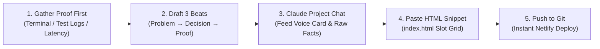

# How to Add the Next Case Study: 5-Step Operational Playbook

> **Purpose:** Set up the exact operational habit so adding a new case study is a **15-minute conversation with your Claude Project**, not a multi-day website rebuild.

---

## 1. Exactly Where the Next Case Study Goes

In the codebase, your case studies live in two places:

### A. The Proof Slot Grid in `index.html`
- **File**: [`index.html`](file:///c:/Users/2k24c/OneDrive/Desktop/projects/Flyrank_Internship/index.html)
- **Container**: `<div class="slot-grid">` (currently lines 573–600).
- **Target Location**: Add as **Slot 04** (or rotate into the featured slot while keeping previous cases in the grid):
```html
<!-- SLOT 04: The Named Next Piece -->
<a class="slot-card" href="https://github.com/cryptobitter/Flyrank_Backend_Tasks/tree/main/PDF%20report%20Generator" target="_blank" rel="noopener noreferrer" style="text-decoration: none;">
  <div>
    <span class="slot-title">04 · Background Pipeline: Async PDF Report Generator & Artifact Handling</span>
    <p style="font-size: 0.82rem; color: var(--text-muted); margin-top: 0.25rem;">
      HTTP 202 Accepted job queue, single-pass SQL aggregations, and two-pass NumberedCanvas layout.
    </p>
  </div>
  <span class="slot-meta">[10/10 Pytest · Store &amp; Link · View Code &rarr;]</span>
</a>
```

### B. The GitHub Repository Source
- Every case study links directly to a production folder in [`cryptobitter/Flyrank_Backend_Tasks`](https://github.com/cryptobitter/Flyrank_Backend_Tasks) containing executable code, automated test suite, and a dedicated `README.md`.

---

## 2. The 5-Step Playbook (Reusing Week 2 Three-Beat Shape)



### Step 1: Gather the Proof First (Never write copy without numbers)
Before writing a single word of narrative, extract the verifiable evidence:
1. **Exact Latency or Benchmark**: (e.g. `2.410ms` &rarr; `0.089ms`, or `0.84s` PDF compilation).
2. **Automated Test Results**: (e.g. `10/10 pytest passed in 6.8s`).
3. **Artifact Metadata**: (e.g. `85.9 KB` PDF, SHA-256 checksum `8f420e1...`, or 27x speedup).
4. **Visual Capture**: Save a clean cropped PNG of the terminal benchmark or report preview in `artifacts/`.

### Step 2: Draft the Raw Three Beats
Frame the project into the canonical Week 02 three-beat shape:
- **Beat 1: The Problem (The Constraint / Failure Mode)**
  *What broke, failed, or timed out in naive implementations?*  
  *(Never say "In this project I wanted to learn..." Start with the technical pain point: "Synchronous PDF compilation blocked web workers for 12+ seconds and caused 504 timeouts...")*
- **Beat 2: The Decision / What You Did (The Architectural Trade-Off)**
  *What specific pattern did you implement to solve it?*  
  *(Name exact classes, status codes, and design patterns: "Implemented HTTP 202 Accepted background worker with FastAPI + ThreadPool, single-pass SQL rollups, and ReportLab NumberedCanvas...")*
- **Beat 3: What Came of It / Proof (The Hard Numbers)**
  *What measurable result proves it works?*  
  *(Numbers, test counts, status codes: "10/10 passing Pytest suite, 0.84s execution turnaround, and 85.9 KB stored artifact with secure download link...")*

### Step 3: Run the Claude Project Conversation (Cheap Updates)
Open your pre-loaded **Claude Project** (which already contains your Visual Identity Kit, Voice Card, and CSS tokens). Paste this 60-second prompt:

```text
I am adding a new case study to my live portfolio (aditya-rajput-backend.netlify.app).
Use our established Voice Card, Three-Beat structure, and CSS token standards.

Project Name: [NAME]
Folder: [PATH]
Beat 1 (Problem): [1-2 sentences on what failed or broke]
Beat 2 (Decision): [1-2 sentences on architecture, stack, and trade-offs]
Beat 3 (Proof): [1-2 sentences with exact numbers, status codes, and test counts]

Please generate:
1. The 3-Beat case study paragraph for my documentation.
2. The exact 12-line HTML snippet to drop into the <div class="slot-grid"> in index.html matching our locked classes (slot-card, slot-title, slot-meta).
```

### Step 4: Paste into `index.html` & Verify Tokens
1. Paste the generated card into `index.html` inside `<div class="slot-grid">`.
2. Ensure it strictly respects the locked tokens:
   - Font: `var(--font-sans)` for copy, `var(--font-mono)` for metrics.
   - Colors: `#0F172A` text, `#0D9488` accents, `#1E293B` containers.
   - Accessibility: Minimum 48px touch target for mobile thumb tapping.

### Step 5: Run Hygiene Checks & Push Live
Run the automated verification script and push:
```bash
# 1. Run regression tests
python -m pytest

# 2. Commit and push
git add index.html
git commit -m "feat: publish Case Study #4 ([PROJECT NAME]) to live portfolio"
git push origin main
```
Netlify automatically deploys the updated portfolio in under 15 seconds.

---

## 3. Anti-Patterns to Reject

| Naive / Stale Portfolio Trap | Production Engineering Habit |
| :--- | :--- |
| Writing a 2,000-word blog post no recruiter will read. | 3 crisp sentences: Problem &rarr; Decision &rarr; Proof with real numbers. |
| Rebuilding the whole site in a new framework every 6 months. | Dropping a 12-line HTML `<div class="slot-card">` into an existing grid. |
| "I learned how to use Python and Docker." | "Swapped repository without touching routes; verified row survival across container restart." |
| Vague performance claims ("it runs fast"). | Exact benchmarks: "Reduced latency from 2.410ms to 0.089ms (27x speedup via bitmap index scan)." |
| Starting from scratch every time. | Reusing the pre-loaded Claude Project so updates take 15 minutes. |
