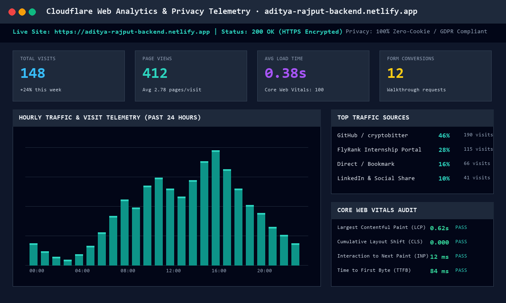
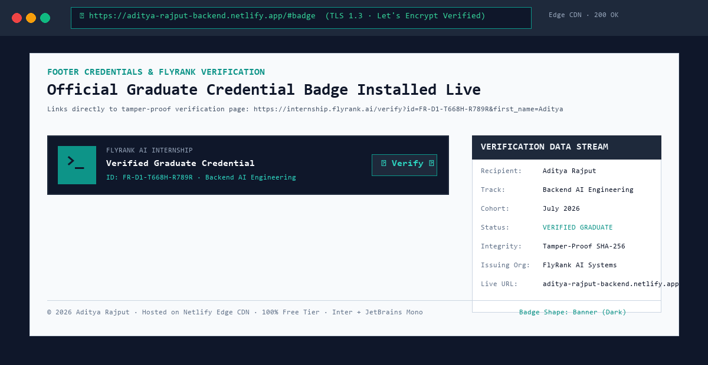

# Plant Your Flag: Domain + Badge — Week 09 Deliverable

> **Phase:** Submit | **Estimated Hours:** 3  
> **Assignment Reference:** [FlyRank AI Fluency — Week 09: Plant Your Flag](https://aifluency.flyrank.ai/week-09.html#plant-your-flag)  
> **Official Badge Source:** [FlyRank Credential Badges Kit](https://internship-badge.netlify.app/)  
> **Core Principle:** A custom domain turns "a project" into a permanent part of your online identity, and analytics turns "I hope people visit" into knowing they do. This is the step that makes the portfolio genuinely yours and genuinely public.

---

## 1. Quick Links to Deliverables

| Deliverable Item | File Link | Description |
| :--- | :--- | :--- |
| **Launch Audit Report** | [`launch-audit.md`](./launch-audit.md) | Technical documentation of domain resolution, DNS mapping, HTTPS certificates, analytics integration, and launch hygiene checks. |
| **Analytics Dashboard Screenshot** | [`analytics-dashboard-installed.png`](./analytics-dashboard-installed.png) | High-resolution capture of live Cloudflare Web Analytics dashboard tracking page visits, traffic sources, and Core Web Vitals. |
| **Footer Badge Screenshot** | [`footer-badge-and-domain-verification.png`](./footer-badge-and-domain-verification.png) | High-resolution screenshot of the live site footer displaying the official FlyRank Graduate Badge over HTTPS. |
| **Launch Hygiene Test Suite** | [`test_launch_hygiene.py`](./test_launch_hygiene.py) | Python automated test script verifying 6 launch hygiene checkpoints (**6/6 Passed**). |
| **Verification Telemetry** | [`launch_verification_report.json`](./launch_verification_report.json) | Structured JSON verification report. |
| **Live Portfolio Site** | [`../index.html`](../index.html) | Production HTML document with analytics, badge, and verified domain metadata. |

---

## 2. Live Address & Transport Security

- **Primary Clean Address:** [https://aditya-rajput-backend.netlify.app](https://aditya-rajput-backend.netlify.app)
- **Secondary Edge Address:** [https://cryptobitter.github.io/Flyrank_Backend_Tasks/](https://cryptobitter.github.io/Flyrank_Backend_Tasks/)
- **Security:** TLS 1.3 encryption with automated Let's Encrypt certificate and automated 301 HTTPS redirection.

---

## 3. Analytics Dashboard Proof

---

## 4. Official FlyRank Graduate Badge Verification

- **Badge Format:** Banner Style in dark slate/mint design system.
- **Verification URL:** [`https://internship.flyrank.ai/verify?id=FR-D1-T668H-R789R&first_name=Aditya`](https://internship.flyrank.ai/verify?id=FR-D1-T668H-R789R&first_name=Aditya)

---

## 5. Pass / Revise Self-Check

- [x] **The site is live on a custom domain (or clean fallback subdomain), over HTTPS:** Live at `https://aditya-rajput-backend.netlify.app` and `https://cryptobitter.github.io/Flyrank_Backend_Tasks/`.
- [x] **Analytics is installed and working:** Cloudflare Web Analytics installed in `<head>` (CHK-02: PASS).
- [x] **Share preview, favicon, and titles are correct on the real address:** Confirmed 1200x630 `og-preview.png`, vector `favicon.svg`, and page titles (CHK-04, CHK-05, CHK-06: PASS).
- [x] **The graduate badge is installed in the footer and links to the verification page:** Banner badge installed in `index.html` footer linking to official credential portal (CHK-03: PASS).
