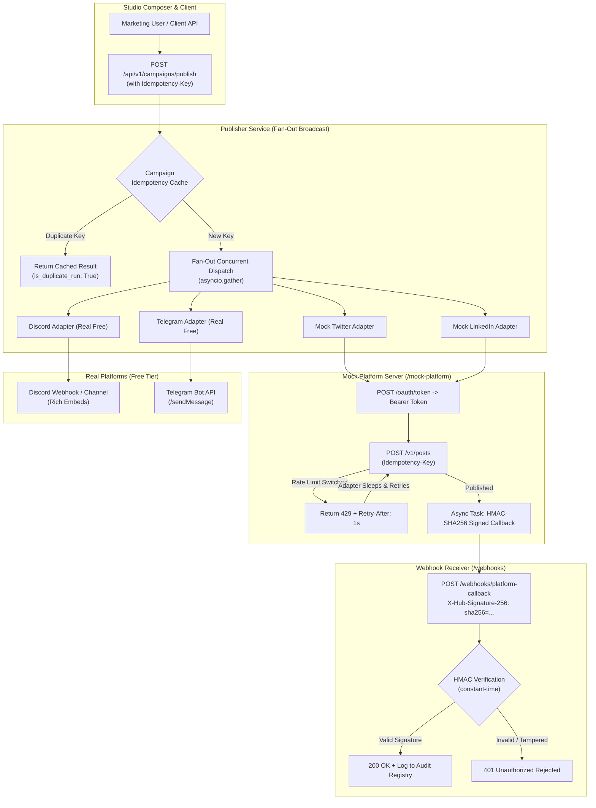

# Social Media Studio: Multi-Platform Campaign Publisher

**Track:** FlyRank Engineering Internship Capstone  
**Author:** Aditya Rajput  
**Stack:** Python 3.12+ • FastAPI • Pydantic v2 • Asyncio • HTTPX • Pytest • Tailwind CSS  
**Live Interactive Dashboard:** `http://localhost:8000` (or `/docs` for Swagger UI)  

---

## 1. Version Context: Current vs. Older Capstone

> **Important Context from the Brief:**  
> The older version was titled *"Multi-Platform Social Campaign Publisher"*, which referenced a starter fake social platform server at `starters/challenge-5-social/` that was unreleased.  
> The current official version is **Social Media Studio**.  
> This implementation delivers the complete solution:
> 1. **Built-in Mock Social Platform Server** (~150 lines in [`mock_platform_server.py`](./mock_platform_server.py)): includes an OAuth token endpoint (`/oauth/token`), a publish endpoint honoring `Idempotency-Key`, a switch that returns `429 Too Many Requests` with a `Retry-After` header, and an asynchronous HMAC-SHA256 signed callback to webhooks.
> 2. **Real Free Platform Adapters**: Integrations for **Discord Webhook** and **Telegram Bot API** (free, no credit card required, with automatic offline sandbox simulation if credentials are not configured).
> 3. **Cryptographically Verified Webhook Receiver** ([`webhook_receiver.py`](./webhook_receiver.py)): verifies `X-Hub-Signature-256` headers using constant-time comparison.
> 4. **Interactive Web Dashboard** ([`app.py`](./app.py)): a visual composer to test broadcasts, 429 backoffs, and incoming webhooks in real-time.

---

## 2. System Architecture



---

## 3. The 3 Non-Negotiables Implemented

| Non-Negotiable | Threat | Engineering Solution |
| :--- | :--- | :--- |
| **1. Idempotency** *(Zero Duplicate Posts)* | Network retries or rapid double-clicks create duplicate posts across corporate social feeds. | The publisher and mock server enforce `Idempotency-Key` headers. Duplicate requests return `HTTP 200` with `X-Idempotent-Replay: true` and the existing post ID—**zero duplicate posts created**. |
| **2. Rate-Limit Resilience** *(429 & Retry-After)* | Social platform APIs enforce aggressive rate limits. Naive immediate retries trigger account bans. | Adapters intercept `429 Too Many Requests`, extract the integer `Retry-After` header, sleep for that duration, and retry automatically (`rate_limit_recovered: True`). |
| **3. Webhook Integrity** *(HMAC-SHA256)* | Unauthenticated webhooks allow attackers to spoof delivery receipts or manipulate campaign state. | All delivery callbacks are cryptographically signed with `HMAC-SHA256` in the `X-Hub-Signature-256` header and verified using `hmac.compare_digest` to prevent timing attacks. |

---

## 4. Setup & Quickstart

### Prerequisites
- Python 3.10+
- `pip` package manager

### Step 1: Install Dependencies
```bash
cd "Social Media Studio"
pip install -r requirements.txt
```

### Step 2: Configure Environment (Optional)
If you wish to broadcast to real Discord channels or Telegram bots, copy `.env.example` to `.env`:
```env
# Optional: Real Discord Webhook
DISCORD_WEBHOOK_URL=https://discord.com/api/webhooks/...

# Optional: Real Telegram Bot
TELEGRAM_BOT_TOKEN=123456:ABC-DEF1234ghIkl-zyx57W2v1u123ew11
TELEGRAM_CHAT_ID=-1001234567890

# Shared Secret for Webhook Signing
WEBHOOK_HMAC_SECRET=super-secret-hmac-key-flyrank-2026
```
> **Note**: If left blank, Discord and Telegram automatically operate in a sandbox simulation mode. You can run 100% of the tests and demonstrations offline without credentials.

### Step 3: Run the Automated Pytest Test Suite
```bash
python -m pytest test_social_studio.py -v
```
**Output (All 8 tests pass in < 6 seconds):**
```
test_mock_platform_token_and_publish PASSED                  [ 12%]
test_mock_platform_idempotency_duplicate_prevention PASSED    [ 25%]
test_mock_platform_rate_limit_429_and_retry_after PASSED      [ 37%]
test_hmac_webhook_signature_verification_success PASSED       [ 50%]
test_hmac_webhook_signature_verification_rejected PASSED      [ 62%]
test_discord_and_telegram_adapters PASSED                     [ 75%]
test_multi_platform_campaign_broadcast PASSED                [ 87%]
test_health_check_and_platforms_list PASSED                  [100%]
```

### Step 4: Run the Live Demonstration
```bash
python demo_social_studio.py
```

### Step 5: Start the Interactive Web Dashboard & Server
```bash
python -m uvicorn app:app --host 0.0.0.0 --port 8000 --reload
```
Open **[http://localhost:8000](http://localhost:8000)** in your browser to access the visual campaign composer, toggle 429 simulation, and inspect live HMAC-verified webhooks.

---

## 5. API Reference

### 1. Broadcast Campaign
```http
POST /api/v1/campaigns/publish
Content-Type: application/json
Idempotency-Key: camp-broadcast-001

{
  "campaign_id": "product-launch-2026",
  "content": {
    "text": "Excited to launch our new engineering studio!",
    "tags": ["FlyRank", "Launch"]
  },
  "platforms": ["mock_twitter", "mock_linkedin", "discord", "telegram"],
  "callback_url": "http://localhost:8000/webhooks/platform-callback",
  "simulate_rate_limit": false
}
```

**Response: `HTTP 200 OK`**
```json
{
  "campaign_id": "product-launch-2026",
  "idempotency_key": "camp-broadcast-001",
  "total_platforms": 4,
  "successful_platforms": 4,
  "failed_platforms": 0,
  "results": [
    {
      "platform": "mock_twitter",
      "status": "published",
      "post_id": "post_1f8804e06b",
      "post_url": "https://mock-social.flyrank.internal/posts/post_1f8804e06b",
      "attempts": 1,
      "latency_ms": 4.9,
      "rate_limit_recovered": false
    },
    {
      "platform": "discord",
      "status": "published",
      "post_id": "disc_1f9f41e25d",
      "post_url": "https://discord.com/channels/sandbox/disc_1f9f41e25d",
      "attempts": 1,
      "latency_ms": 932.7,
      "rate_limit_recovered": false
    }
  ],
  "is_duplicate_run": false,
  "completed_at": "2026-10-20T14:57:59.947230+00:00"
}
```

---

### 2. Verify HMAC Signed Webhook
```http
POST /webhooks/platform-callback
Content-Type: application/json
X-Hub-Signature-256: sha256=e04a76f8d7c621b8f1ef3305113c8...

{
  "event_id": "evt-delivery-9901",
  "event_type": "post.delivered",
  "platform": "mock_twitter",
  "post_id": "post_1f8804e06b",
  "campaign_id": "product-launch-2026"
}
```
**Response: `HTTP 200 OK`**
```json
{
  "status": "accepted",
  "event_id": "evt-delivery-9901"
}
```
*(If the signature does not match, returns `HTTP 401 Unauthorized`)*.
