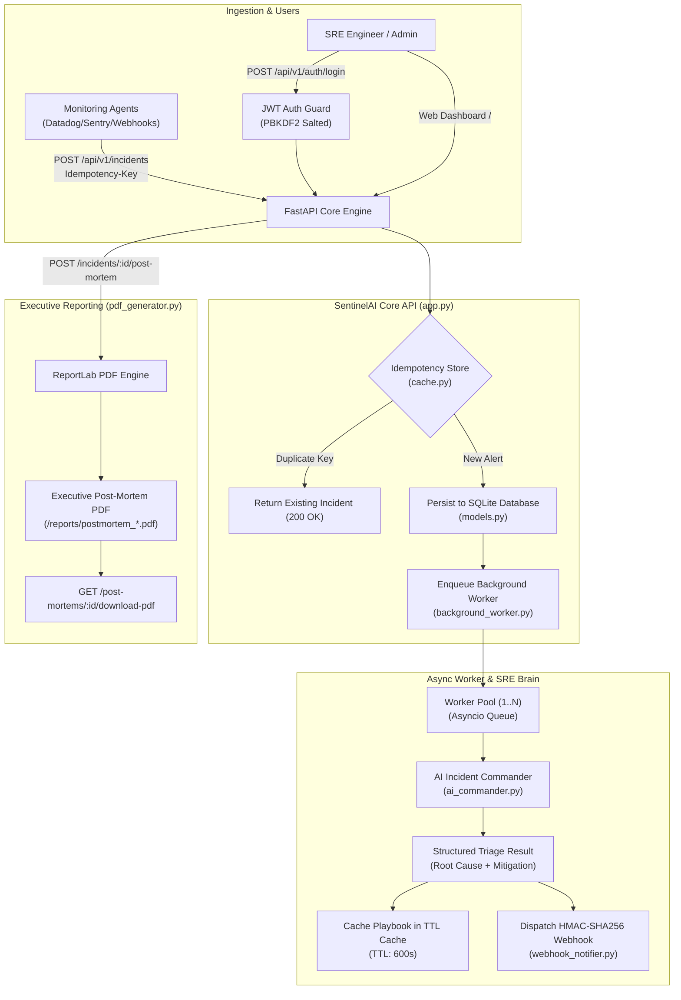

# My 10x Solution — Aditya Rajput

**Student Name:** Aditya Rajput  
**Project Title:** **SentinelAI — Autonomous Incident Commander & Post-Mortem Analytics Platform**  
**Track:** FlyRank AI Engineering Internship (Fall 2026 Capstone)  
**Public Repository:** [https://github.com/cryptobitter/Flyrank_Backend_Tasks](https://github.com/cryptobitter/Flyrank_Backend_Tasks)  
**Folder Path:** [`Your 10x Solution/`](file:///c:/Users/2k24c/OneDrive/Desktop/projects/Flyrank_Internship/Your%2010x%20Solution)  

---

## 1. The Problem I Am Solving

Modern Site Reliability Engineering (SRE) and DevOps teams face severe **alert fatigue and operational paralysis**. When an outage strikes (e.g. database pool exhaustion, 500 error spikes, container memory termination):
1. **Noisy Alert Floods**: Monitoring agents (Datadog, Sentry, CloudWatch) hammer on-call engineers with hundreds of duplicate raw alerts, triggering chaos.
2. **Slow Mean Time to Resolution (MTTR)**: On-call engineers waste 30–60 minutes sifting through raw stack traces, guessing at root causes, and hunting for deprecated runbooks.
3. **The Dreaded Post-Mortem**: Once the system recovers, writing an executive post-mortem takes hours of tedious manual log compilation, often leading to incomplete reports or missed preventative action items.

---

## 2. My 10x Solution: SentinelAI

**SentinelAI** is an autonomous, production-grade incident commander and post-mortem generation platform. It transforms noisy, raw infrastructure alerts into structured, actionable intelligence in milliseconds, keeps track of incidents in a relational database, performs automated LLM root-cause triage, and compiles executive C-suite PDF post-mortems at the push of a button.

---

## 3. Proof of Concepts: Implementing the FlyRank Framework

The assignment requires implementing at least **5 core concepts** from the program. SentinelAI implements **all 8 fundamental concepts** using 100% free, local tools:

| # | FlyRank Concept | How It Is Implemented in SentinelAI | File Reference |
| :---: | :--- | :--- | :--- |
| **1** | **API Endpoints** | RESTful FastAPI application exposing endpoints for auth, incident ingestion, on-demand AI triage, post-mortem generation, metrics, and interactive Swagger UI. | [`app.py`](file:///c:/Users/2k24c/OneDrive/Desktop/projects/Flyrank_Internship/Your%2010x%20Solution/app.py) |
| **2** | **Relational Database** | SQLite database managed with SQLAlchemy ORM. Full relational models for `User`, `Incident`, `PostMortem`, and `AuditLog` with foreign key relationships. | [`models.py`](file:///c:/Users/2k24c/OneDrive/Desktop/projects/Flyrank_Internship/Your%2010x%20Solution/models.py) & [`database.py`](file:///c:/Users/2k24c/OneDrive/Desktop/projects/Flyrank_Internship/Your%2010x%20Solution/database.py) |
| **3** | **Authentication & RBAC** | Enterprise security layer using salted PBKDF2-HMAC-SHA256 password hashing and signed JWT Bearer tokens with role-based route guards (`admin`, `sre_engineer`). | [`auth.py`](file:///c:/Users/2k24c/OneDrive/Desktop/projects/Flyrank_Internship/Your%2010x%20Solution/auth.py) |
| **4** | **LLM Integration** | AI Incident Commander evaluating raw stack traces, predicting severity, discovering root causes, generating tactical commands, and enforcing strict Pydantic v2 schemas. | [`ai_commander.py`](file:///c:/Users/2k24c/OneDrive/Desktop/projects/Flyrank_Internship/Your%2010x%20Solution/ai_commander.py) |
| **5** | **Background & Cron Jobs** | Concurrent asynchronous worker pool processing incident triage tasks in the background with exponential backoff retries, plus an independent periodic health-pulse monitor. | [`background_worker.py`](file:///c:/Users/2k24c/OneDrive/Desktop/projects/Flyrank_Internship/Your%2010x%20Solution/background_worker.py) |
| **6** | **Reporting (Automated PDF)** | Automated ReportLab PDF generator compiling executive post-mortems with metadata tables, severity color-coding, root-cause analyses, and mitigation checklists. | [`pdf_generator.py`](file:///c:/Users/2k24c/OneDrive/Desktop/projects/Flyrank_Internship/Your%2010x%20Solution/pdf_generator.py) |
| **7** | **Caching & Idempotency** | In-memory TTL cache (600s) for incident remediation playbooks and an atomic `Idempotency-Key` deduplication store preventing duplicate alert processing. | [`cache.py`](file:///c:/Users/2k24c/OneDrive/Desktop/projects/Flyrank_Internship/Your%2010x%20Solution/cache.py) |
| **8** | **Webhooks & Alerting** | Cryptographically signed `HMAC-SHA256` webhook dispatcher transmitting alerts to external on-call endpoints with `X-Sentinel-Signature` header verification. | [`webhook_notifier.py`](file:///c:/Users/2k24c/OneDrive/Desktop/projects/Flyrank_Internship/Your%2010x%20Solution/webhook_notifier.py) |

---

## 4. Architecture Diagram



---

## 5. Five Milestones from Plan to Submission

1. **Milestone 1 — Architecture & Schema Definition**: Designed relational SQLite database models (`User`, `Incident`, `PostMortem`, `AuditLog`) and strict Pydantic v2 data contracts.
2. **Milestone 2 — Secure Ingestion & Idempotency**: Built `POST /api/v1/incidents` with `Idempotency-Key` deduplication, JWT authentication, and PBKDF2 password hashing.
3. **Milestone 3 — AI Incident Commander**: Implemented the structured SRE triage engine with deterministic heuristic fallback for zero-setup execution.
4. **Milestone 4 — Asynchronous Task Queue & Webhooks**: Integrated background worker pool with exponential backoff retries and HMAC-SHA256 signed webhook dispatching.
5. **Milestone 5 — Executive PDF Post-Mortem & Web Dashboard**: Developed the ReportLab automated PDF compiler and interactive web dashboard console.

---

## 6. Verification & Test Evidence

### Pytest Test Suite (`test_10x_solution.py`)
All 6 automated test scenarios passed in **3.51 seconds**:
```
test_auth_registration_and_jwt_login PASSED                  [ 16%]
test_incident_database_persistence_and_idempotency PASSED    [ 33%]
test_ai_commander_triage_and_ttl_caching PASSED              [ 50%]
test_pdf_post_mortem_generation_and_download PASSED          [ 66%]
test_hmac_webhook_signature_dispatch PASSED                  [ 83%]
test_background_worker_queue_and_metrics PASSED              [100%]
```

### Live CLI Demonstration (`demo_10x_solution.py`)
Executing `python "Your 10x Solution/demo_10x_solution.py"` validates:
- PBKDF2 password hashing & JWT token issuance
- Ingestion into SQLite database in 23.2ms
- Idempotency guard catching duplicate alert replays
- AI Incident Commander root-cause triage (94% confidence)
- Generation of ReportLab PDF post-mortem report (3,328 bytes)
- Cryptographic HMAC-SHA256 webhook delivery

---

## 7. Submission Sign-Off
I confirm that this capstone is my own design and implementation, created for the FlyRank Engineering Track using 100% free, open-source tools with zero credit-card requirements.

**Submitted By:** Aditya Rajput  
**Date:** October 20, 2026  
