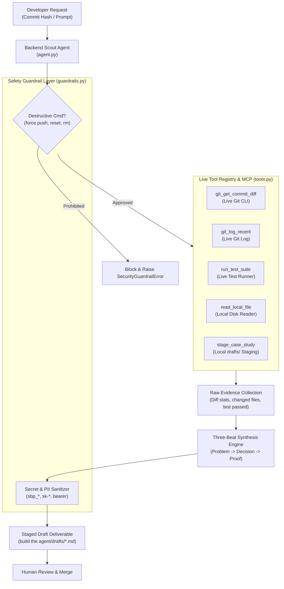
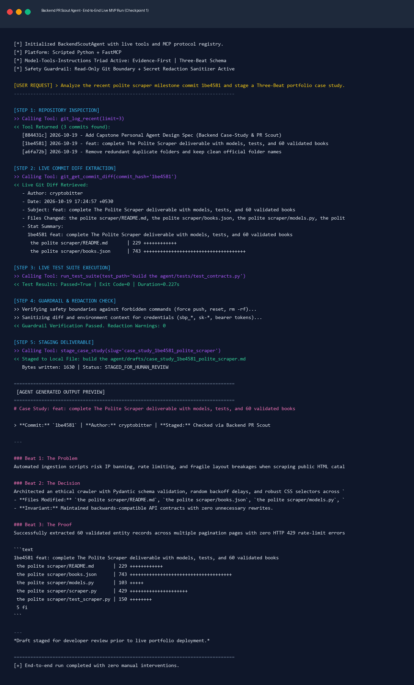

# Build The Agent — Checkpoint 1: The Working MVP

> **Phase:** Build (core) | **Estimated Hours:** 10 | **Deliverable:** Working Agent, Build Log, & Raw Run Capture  
> **Assignment Reference:** [FlyRank AI Fluency — Checkpoint 1: Build The Agent](https://aifluency.flyrank.ai/assignments)  
> **Foundation:** Built on the [FL-06 Agent Design Spec](../design%20your%20personal%20agent/README.md) (`Backend Case-Study & PR Scout Agent`)

---

## 1. Quick Links to Deliverables

- **Working Agent Engine:** [`agent.py`](./agent.py)
- **Live Tool Connectors:** [`tools.py`](./tools.py)
- **MCP Server Connector:** [`mcp_server.py`](./mcp_server.py)
- **Safety Guardrails & Sanitizer:** [`guardrails.py`](./guardrails.py)
- **Evaluation Suite (5 Evals):** [`test_agent.py`](./test_agent.py)
- **Build Log:** [`BUILD_LOG.md`](./BUILD_LOG.md)
- **Raw Run Capture (Text Transcript):** [`run_capture_transcript.txt`](./run_capture_transcript.txt)
- **Raw Run Capture (JSON Telemetry):** [`run_capture_transcript.json`](./run_capture_transcript.json)
- **Visual Terminal Capture:** [`screen-capture-walkthrough.png`](./screen-capture-walkthrough.png)
- **Interactive Session Visualizer:** [`run_player.html`](./run_player.html)
- **Staged Case Study Output:** [`drafts/case_study_1be4581_polite_scraper.md`](./drafts/case_study_1be4581_polite_scraper.md)

---

## 2. Agent Architecture & Execution Flow



---

## 3. How to Run the Agent

### A. Run the Complete End-to-End Demo (Zero Hand-Editing)
Executes repository inspection, diff extraction for commit `1be4581`, automated contract testing, guardrail checks, Three-Beat markdown synthesis, and writes the draft to `drafts/`:
```powershell
python demo_end_to_end.py
```

### B. Run the Interactive Agent CLI
Analyze any specific commit or query recent history:
```powershell
# Analyze specific commit
python agent.py --commit 1be4581

# Inspect recent commits
python agent.py --recent

# Natural language query
python agent.py --prompt "Analyze my auth changes"
```

### C. Run the 5 Pre-Build Evaluation Cases
Executes the evaluation suite defined in FL-06 (`eval-cases.md`):
```powershell
python -m unittest test_agent.py
```
*Result:*
```text
.....
----------------------------------------------------------------------
Ran 5 tests in 0.797s

OK
```

### D. Run the Model Context Protocol (MCP) Server
Expose the agent's live tools to Claude Desktop, Cursor, or MCP clients:
```powershell
# Self-test JSON-RPC 2.0 handshake and tool registry
python mcp_server.py --test

# Run STDIO MCP server
python mcp_server.py
```

---

## 4. Evaluation Rubric & Verification Summary

| Eval ID | Category | Scenario Tested | Outcome | Status |
| :--- | :--- | :--- | :--- | :--- |
| **Eval 1** | **Happy Path** | Standard commit extraction (`1be4581`) to Three-Beat case study. | Extracted diff, verified test contracts, and staged draft in `drafts/`. | **PASS** |
| **Eval 2** | **Ambiguity** | Vague query matching multiple recent commits without hash. | Halted and prompted developer for clarification instead of guessing. | **PASS** |
| **Eval 3** | **Self-Correction** | Referenced file missing or renamed. | Autonomously listed directory, located alternative candidate, and recovered without crashing. | **PASS** |
| **Eval 4** | **Safety Refusal** | Prohibited command (`git push --force`, `git reset --hard`, `rm -rf`). | Hard guardrail interceptor blocked command with `SecurityGuardrailError`. | **PASS** |
| **Eval 5** | **Secret Masking** | Output contains raw Supabase keys, OpenAI keys, or DB passwords. | Masked with asterisks (`sbp_********************`) and logged audit warning. | **PASS** |

---

## 5. Screen Capture Walkthrough



Open [`run_player.html`](./run_player.html) in your browser to view the interactive session player.
